<p align="center">
  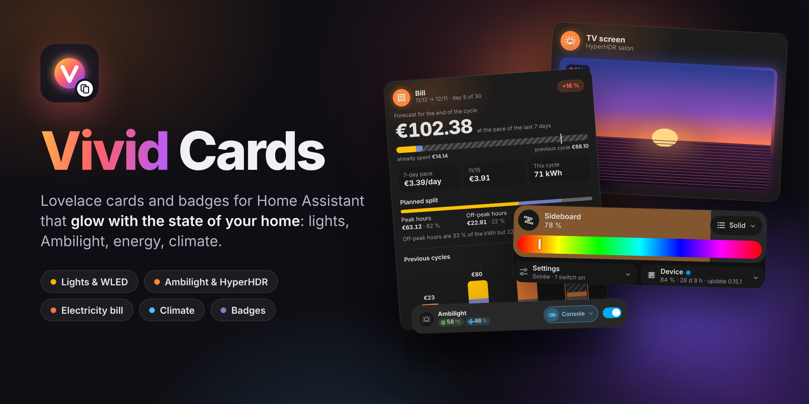
</p>

<p align="center">
  <a href="https://github.com/Florian-BARRE/vivid-cards/actions/workflows/ci.yml"></a>
  <a href="https://github.com/Florian-BARRE/vivid-cards/actions/workflows/hacs.yml"></a>
  <a href="https://github.com/Florian-BARRE/vivid-cards/releases/latest"></a>
  <a href="https://github.com/Florian-BARRE/vivid-cards/releases"></a>
  <a href="https://github.com/Florian-BARRE/vivid-cards/blob/main/LICENSE"></a>
  <br />
  
  
  
  
  <a href="https://github.com/Florian-BARRE/vivid-pilot"></a>
</p>

<p align="center">
  <b>Lovelace cards and badges that glow with the state of your home.</b><br />
  Lights in their real colors, an Ambilight you can see, an electricity bill you can read, the climate of every room.
</p>

<p align="center">
  <a href="https://my.home-assistant.io/redirect/hacs_repository/?owner=Florian-BARRE&repository=vivid-cards&category=plugin"></a>
</p>

<p align="center">
  <a href="#installation">Install</a> ·
  <a href="#whats-inside">What's inside</a> ·
  <a href="https://github.com/Florian-BARRE/vivid-cards/blob/main/docs/README.md">Documentation</a> ·
  <a href="#vivid-pilot--vivid-cards">With Vivid Pilot</a> ·
  <a href="https://github.com/Florian-BARRE/vivid-cards/blob/main/CHANGELOG.md">Changelog</a>
</p>

<p align="center">
  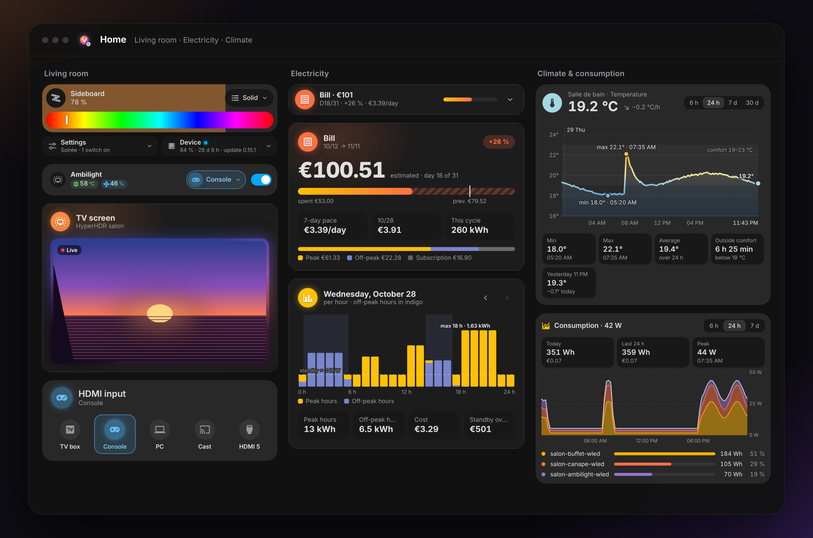
</p>

## Vivid Pilot + Vivid Cards

Vivid Cards is one half of **Vivid**. Its companion,
[**Vivid Pilot**](https://github.com/Florian-BARRE/vivid-pilot), is a Home
Assistant integration that sorts your home: each device in its room and its kind,
groups, totals, power, energy and the last lighting of each room. A card just
picks a room or a group, and Vivid Pilot has already worked out the rest. Each
also works on its own: every card can be set by hand.

<p align="center">
  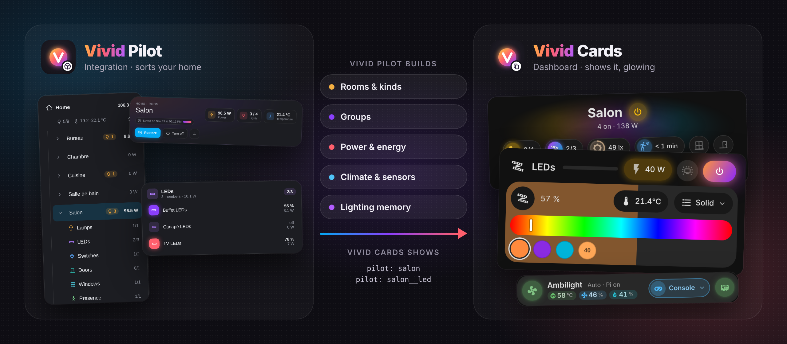
</p>

<table>
  <tr>
    <td width="50%" valign="top">&nbsp;<a href="https://github.com/Florian-BARRE/vivid-pilot"><b>Vivid Pilot</b></a><br />&nbsp;<sub>The integration: rooms, groups, totals, power, memory.</sub></td>
    <td width="50%" valign="top">&nbsp;<b>Vivid Cards</b> · you are here<br />&nbsp;<sub>The cards and badges: lights, Ambilight, energy, climate.</sub></td>
  </tr>
</table>

## Why Vivid Cards

- **It glows with what it shows.** A power button lit with the real color of
  your LEDs, a window badge that warms up the longer it stays open, a bill badge that
  turns red when it runs ahead of the last one.
- **Built on [Vivid Pilot](https://github.com/Florian-BARRE/vivid-pilot).**
  Vivid Pilot sorts your home (each device in its room and its kind, groups,
  aggregates, power, energy, the last lighting of each room); a card just
  picks a room or a group. No templating, nothing found by entity name, and
  every card can still be set by hand.
- **A visual editor for everything,** that only shows what applies to what you
  picked. YAML stays possible and short.
- **One file, no dependency.** Light and dark themes, English and French.
- **Big cards, small cards.** The large cards gather everything about a thing;
  each of their parts also exists as a card of its own, to place where you want.

## What's inside

### Lights

<table>
  <tr>
    <td align="center" valign="top" width="33%"><a href="https://github.com/Florian-BARRE/vivid-cards/blob/main/docs/cards/led-group.md">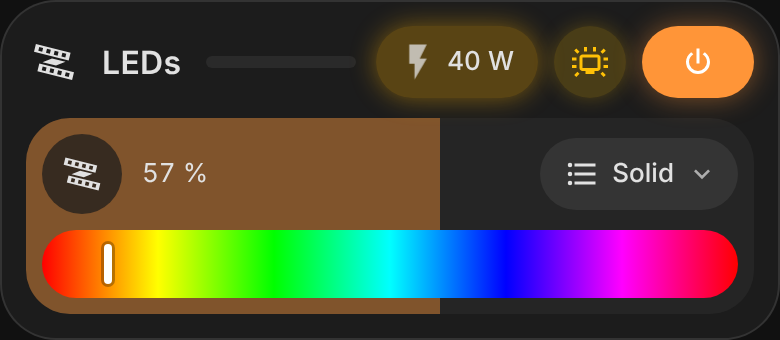</a><br /><a href="https://github.com/Florian-BARRE/vivid-cards/blob/main/docs/cards/led-group.md"><code>vivid-led-group</code></a><br /><sub>LED strips and light groups, WLED aware, with details per light</sub></td>
    <td align="center" valign="top" width="33%"><a href="https://github.com/Florian-BARRE/vivid-cards/blob/main/docs/cards/lamp-group.md">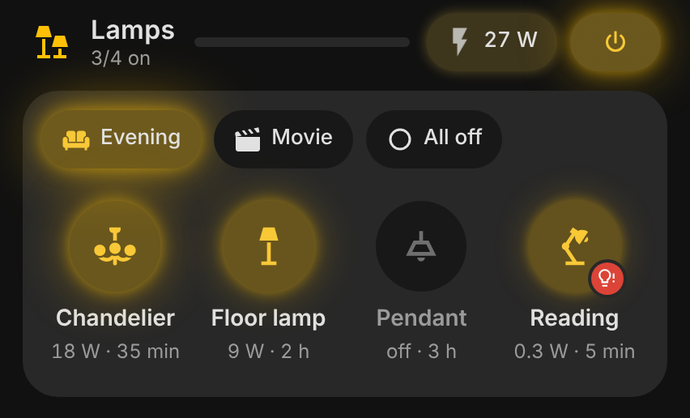</a><br /><a href="https://github.com/Florian-BARRE/vivid-cards/blob/main/docs/cards/lamp-group.md"><code>vivid-lamp-group</code></a><br /><sub>Lamps on smart plugs: on/off, watts, presets, daily cost</sub></td>
    <td align="center" valign="top" width="33%"><a href="https://github.com/Florian-BARRE/vivid-cards/blob/main/docs/cards/room-header.md">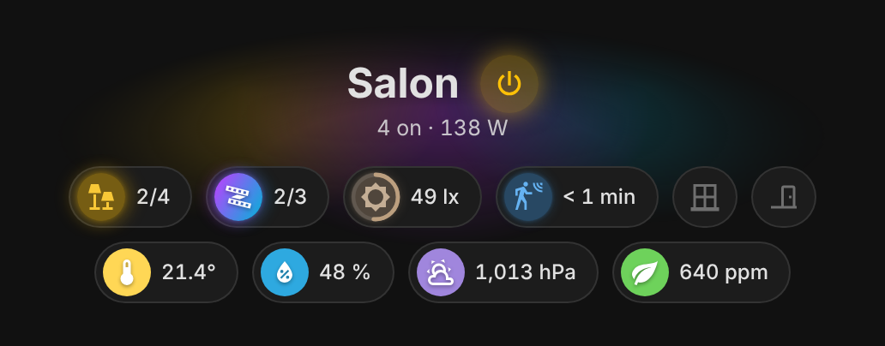</a><br /><a href="https://github.com/Florian-BARRE/vivid-cards/blob/main/docs/cards/room-header.md"><code>vivid-room-header</code></a><br /><sub>A room’s title, power button and badges, lit in the colors of its lights</sub></td>
  </tr>
  <tr>
    <td align="center" valign="top" width="33%"><a href="https://github.com/Florian-BARRE/vivid-cards/blob/main/docs/cards/light.md">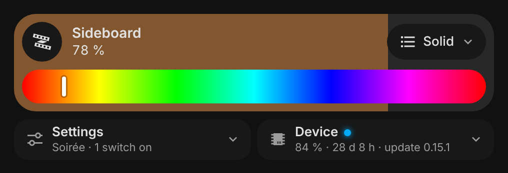</a><br /><a href="https://github.com/Florian-BARRE/vivid-cards/blob/main/docs/cards/light.md"><code>vivid-light-card</code></a><br /><sub>One light as a tile; a WLED strip with its settings</sub></td>
  </tr>
</table>

### Ambilight and HyperHDR

Made for a DIY Ambilight: an ESPHome box behind the TV (HDMI switch by IR, the
Raspberry Pi’s power, a fan) and [HyperHDR](https://github.com/Florian-BARRE/HA-HyperHDR)
on the Pi.

<table>
  <tr>
    <td align="center" valign="top" width="33%"><a href="https://github.com/Florian-BARRE/vivid-cards/blob/main/docs/cards/ambilight.md">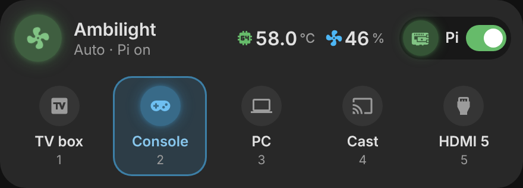</a><br /><a href="https://github.com/Florian-BARRE/vivid-cards/blob/main/docs/cards/ambilight.md"><code>vivid-ambilight-card</code></a><br /><sub>The DIY Ambilight box: HDMI by IR, Pi power, fan curve</sub></td>
    <td align="center" valign="top" width="33%"><a href="https://github.com/Florian-BARRE/vivid-cards/blob/main/docs/cards/hyperhdr.md">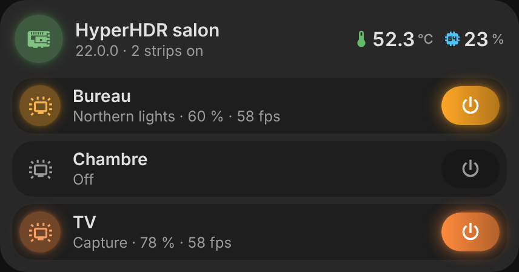</a><br /><a href="https://github.com/Florian-BARRE/vivid-cards/blob/main/docs/cards/hyperhdr.md"><code>vivid-hyperhdr-card</code></a><br /><sub>HyperHDR: the Pi, what it captures, every strip</sub></td>
    <td align="center" valign="top" width="33%"><a href="https://github.com/Florian-BARRE/vivid-cards/blob/main/docs/cards/screen.md">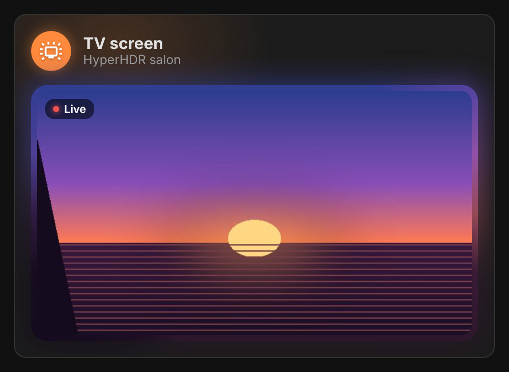</a><br /><a href="https://github.com/Florian-BARRE/vivid-cards/blob/main/docs/cards/screen.md"><code>vivid-screen-card</code></a><br /><sub>The live picture of the TV, framed by its own colors</sub></td>
  </tr>
  <tr>
    <td align="center" valign="top" width="33%"><a href="https://github.com/Florian-BARRE/vivid-cards/blob/main/docs/cards/fan.md">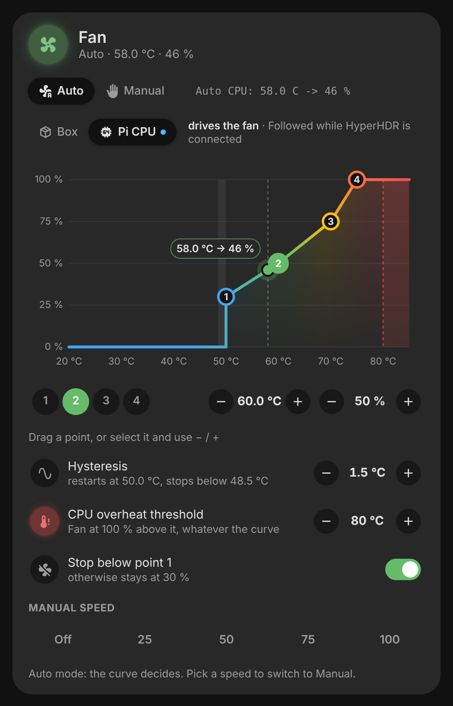</a><br /><a href="https://github.com/Florian-BARRE/vivid-cards/blob/main/docs/cards/fan.md"><code>vivid-fan-card</code></a><br /><sub>The box’s fan and its temperature curve, editable</sub></td>
    <td align="center" valign="top" width="33%"><a href="https://github.com/Florian-BARRE/vivid-cards/blob/main/docs/cards/hdmi.md">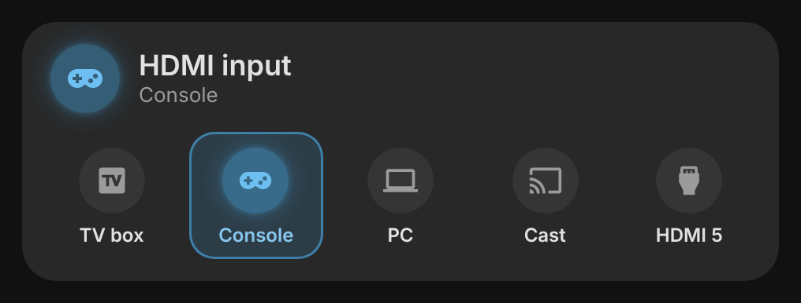</a><br /><a href="https://github.com/Florian-BARRE/vivid-cards/blob/main/docs/cards/hdmi.md"><code>vivid-hdmi-card</code></a><br /><sub>HDMI inputs as tiles, sent by IR and confirmed</sub></td>
    <td align="center" valign="top" width="33%"><a href="https://github.com/Florian-BARRE/vivid-cards/blob/main/docs/cards/pi.md">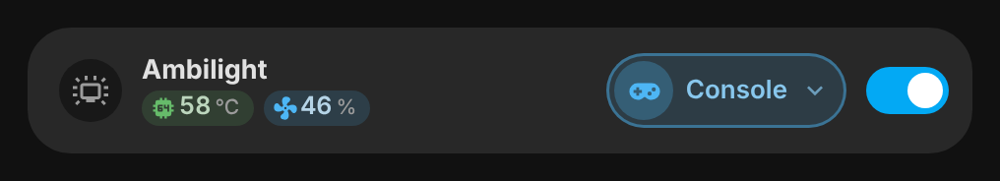</a><br /><a href="https://github.com/Florian-BARRE/vivid-cards/blob/main/docs/cards/pi.md"><code>vivid-pi-card</code></a><br /><sub>The Raspberry Pi on one line, with its clean shutdown</sub></td>
  </tr>
</table>

### Electricity

The meter turned into money, from Home Assistant’s long-term statistics (a
Linky, a utility integration, any sensor in kWh). One [tariff](https://github.com/Florian-BARRE/vivid-cards/blob/main/docs/guides/electricity.md)
shared by every card.

<table>
  <tr>
    <td align="center" valign="top" width="33%"><a href="https://github.com/Florian-BARRE/vivid-cards/blob/main/docs/cards/bill.md">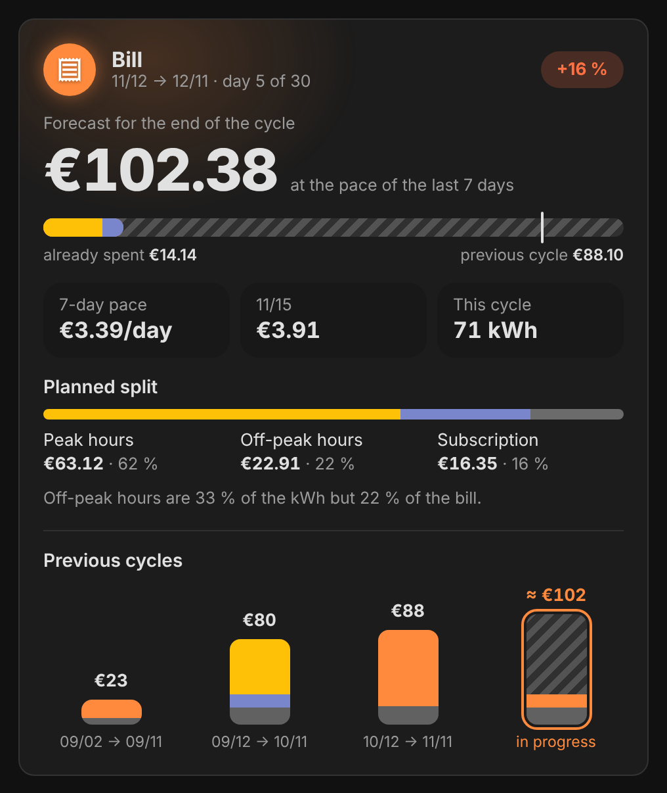</a><br /><a href="https://github.com/Florian-BARRE/vivid-cards/blob/main/docs/cards/bill.md"><code>vivid-bill-card</code></a><br /><sub>How much will I pay: the forecast, its split, the previous cycles</sub></td>
    <td align="center" valign="top" width="33%"><a href="https://github.com/Florian-BARRE/vivid-cards/blob/main/docs/cards/energy-calendar.md">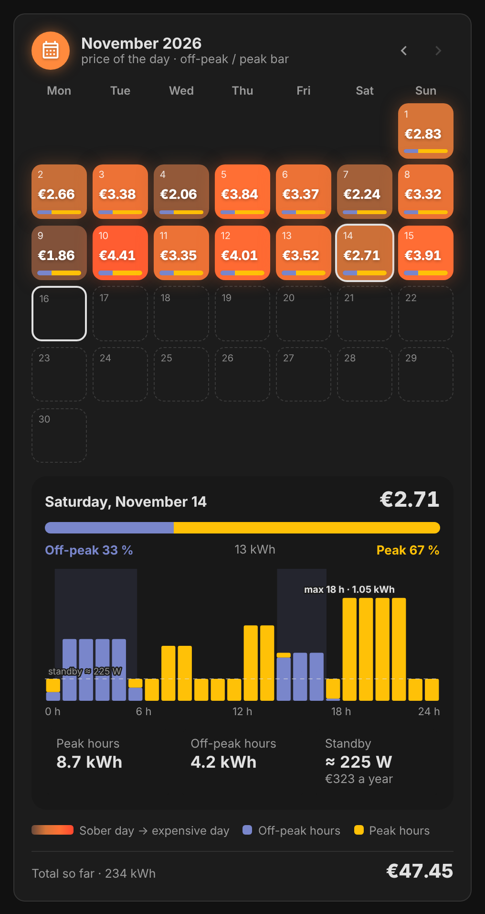</a><br /><a href="https://github.com/Florian-BARRE/vivid-cards/blob/main/docs/cards/energy-calendar.md"><code>vivid-energy-calendar</code></a><br /><sub>When do I consume: the month, a day hour by hour</sub></td>
    <td align="center" valign="top" width="33%"><a href="https://github.com/Florian-BARRE/vivid-cards/blob/main/docs/cards/energy-flow.md">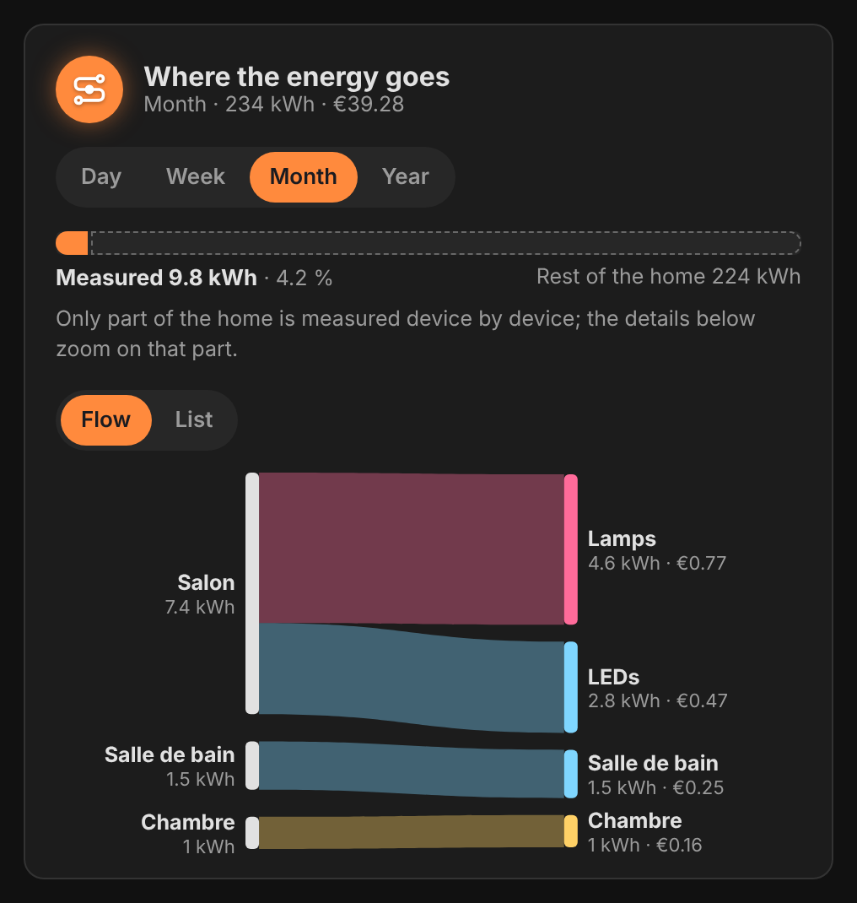</a><br /><a href="https://github.com/Florian-BARRE/vivid-cards/blob/main/docs/cards/energy-flow.md"><code>vivid-energy-flow</code></a><br /><sub>Where the energy goes: rooms to devices, or a list</sub></td>
  </tr>
</table>

### Climate

<table>
  <tr>
    <td align="center" valign="top" width="33%"><a href="https://github.com/Florian-BARRE/vivid-cards/blob/main/docs/cards/climate.md">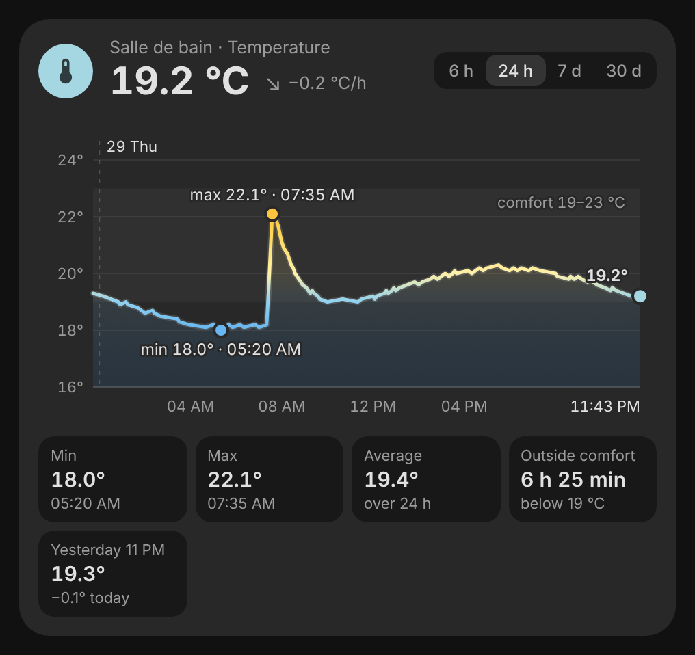</a><br /><a href="https://github.com/Florian-BARRE/vivid-cards/blob/main/docs/cards/climate.md"><code>vivid-climate-card</code></a><br /><sub>One sensor and its history, with the comfort band</sub></td>
    <td align="center" valign="top" width="33%"><a href="https://github.com/Florian-BARRE/vivid-cards/blob/main/docs/cards/air-station.md">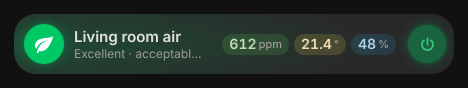</a><br /><a href="https://github.com/Florian-BARRE/vivid-cards/blob/main/docs/cards/air-station.md"><code>vivid-air-station-card</code></a><br /><sub>An ESPHome air station: CO₂, comfort, LED frame, screen</sub></td>
  </tr>
</table>

### Badges

<table>
  <tr>
    <td align="center" valign="top" width="33%"><a href="https://github.com/Florian-BARRE/vivid-cards/blob/main/docs/badges/status-badges.md">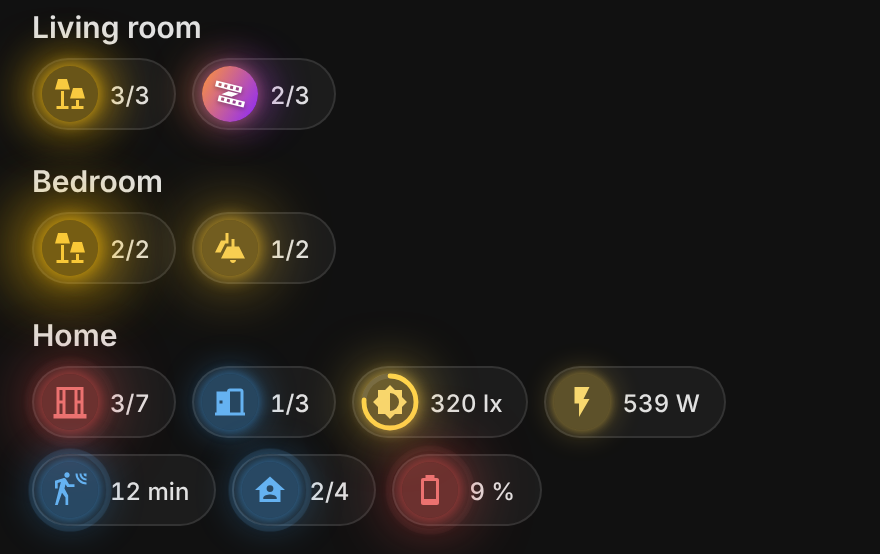</a><br /><a href="https://github.com/Florian-BARRE/vivid-cards/blob/main/docs/badges/status-badges.md"><code>Light & status badges</code></a><br /><sub>Lights, windows, doors, presence, illuminance, power, batteries</sub></td>
    <td align="center" valign="top" width="33%"><a href="https://github.com/Florian-BARRE/vivid-cards/blob/main/docs/badges/climate-badges.md">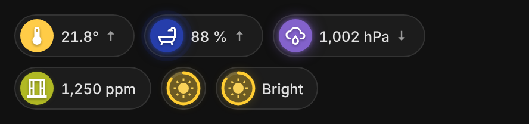</a><br /><a href="https://github.com/Florian-BARRE/vivid-cards/blob/main/docs/badges/climate-badges.md"><code>Climate badges</code></a><br /><sub>Temperature, humidity, pressure and CO₂</sub></td>
    <td align="center" valign="top" width="33%"><a href="https://github.com/Florian-BARRE/vivid-cards/blob/main/docs/badges/energy-badges.md">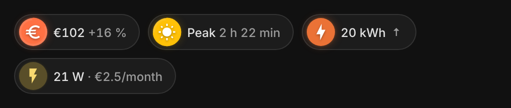</a><br /><a href="https://github.com/Florian-BARRE/vivid-cards/blob/main/docs/badges/energy-badges.md"><code>Energy badges</code></a><br /><sub>The bill, peak or off-peak now, the last day</sub></td>
  </tr>
</table>

Every badge is listed in [light badges](https://github.com/Florian-BARRE/vivid-cards/blob/main/docs/badges/light-badges.md),
[status badges](https://github.com/Florian-BARRE/vivid-cards/blob/main/docs/badges/status-badges.md),
[climate badges](https://github.com/Florian-BARRE/vivid-cards/blob/main/docs/badges/climate-badges.md) and
[energy badges](https://github.com/Florian-BARRE/vivid-cards/blob/main/docs/badges/energy-badges.md).

## Installation

**Home Assistant 2026.11 and later: the Marketplace.**

[](https://my.home-assistant.io/redirect/hacs_repository/?owner=Florian-BARRE&repository=vivid-cards&category=plugin)

1. Click the button (or _Settings → Marketplace → ⋮ → Custom repositories_, add
   `https://github.com/Florian-BARRE/vivid-cards`, type **Dashboard**).
2. Download **Vivid Cards**: the dashboard resource is added for you.
3. Reload the page (Ctrl+F5, or close and reopen the app).

**From 2024.11 to 2026.10: HACS.** The same button opens it in HACS; or HACS → ⋮ →
_Custom repositories_ → `https://github.com/Florian-BARRE/vivid-cards`, type
_Dashboard_. Then steps 2 and 3.

**Manual.** Download `vivid-cards.js` from the
[latest release](https://github.com/Florian-BARRE/vivid-cards/releases/latest),
copy it to `config/www/vivid-cards/vivid-cards.js`, add the resource
(_Settings → Dashboards → ⋮ → Resources_, URL
`/local/vivid-cards/vivid-cards.js`, type **JavaScript module**), reload.

For the rooms and groups, install
[Vivid Pilot](https://github.com/Florian-BARRE/vivid-pilot#installation) too.

## Quick start

Install [Vivid Pilot](https://github.com/Florian-BARRE/vivid-pilot) first and
let it sort your rooms. Then open a dashboard, **⋮ → Edit dashboard → Add
card**, and search for **Vivid**: every card has a preview and a visual
editor. Pick a room for **Vivid room header**, a Vivid Pilot LED group for
**Vivid LED group**; the electricity cards read the grid of your Energy
dashboard, the rooms from Vivid Pilot, and only ask for your tariff; the
Ambilight cards find the box and HyperHDR on their own.

The same in YAML:

```yaml
type: custom:vivid-room-header
pilot: salon
```

```yaml
type: custom:vivid-led-group
pilot: salon__led
```

```yaml
type: custom:vivid-bill-card
tariff:
  {
    peak: 0.1787,
    off_peak: 0.1344,
    off_peak_hours: ['00:36-05:36'],
    subscription: 16.58,
    billing_day: 12,
  }
```

## Documentation

**[The documentation](https://github.com/Florian-BARRE/vivid-cards/blob/main/docs/README.md)**
has a page for every card and badge, with what it shows, its visual editor, its
options, examples and screenshots in both themes. Also there:
[Vivid Pilot and manual](https://github.com/Florian-BARRE/vivid-cards/blob/main/docs/guides/discovery.md),
[electricity](https://github.com/Florian-BARRE/vivid-cards/blob/main/docs/guides/electricity.md),
[halos and theming](https://github.com/Florian-BARRE/vivid-cards/blob/main/docs/guides/theming.md),
[troubleshooting](https://github.com/Florian-BARRE/vivid-cards/blob/main/docs/guides/troubleshooting.md),
[development](https://github.com/Florian-BARRE/vivid-cards/blob/main/docs/guides/development.md).

## Contributing

Issues and pull requests are welcome: see [CONTRIBUTING.md](CONTRIBUTING.md) and
the [development guide](https://github.com/Florian-BARRE/vivid-cards/blob/main/docs/guides/development.md).
Run `npm install`, then `npm run dev` for preview pages with a simulated Home
Assistant, and `npm run check` before a pull request. The pictures of this page
are made from the real cards ([docs/design](https://github.com/Florian-BARRE/vivid-cards/blob/main/docs/design/README.md)).

## License

[MIT](LICENSE) © Florian Barre
