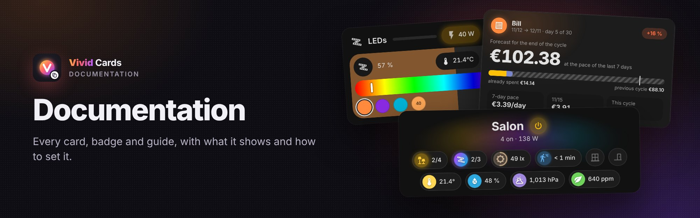

  

<a href="../README.md">Vivid Cards</a> › Documentation

# Vivid Cards documentation

Every card and badge has its own page: what it shows, its visual editor, its
options, examples and screenshots in both themes. The cards read their rooms and
groups from [Vivid Pilot](https://github.com/Florian-BARRE/vivid-pilot), the
integration that sorts your home, or take what you pick by hand. New here?
Start with the [installation](../README.md#installation).

## Cards

### Lights

| Card                                        | What it is for                                                        |
| ------------------------------------------- | --------------------------------------------------------------------- |
| [`vivid-led-group`](cards/led-group.md)     | A light group or a single light, WLED aware, with details per light   |
| [`vivid-lamp-group`](cards/lamp-group.md)   | Lamps on smart plugs or switches: on/off, watts, presets, daily cost  |
| [`vivid-room-header`](cards/room-header.md) | A room's title, power button, lights on and watts, real-color halo    |
| [`vivid-light-card`](cards/light.md)        | One light as a tile; a WLED strip with its Settings and Device panels |

### Ambilight and HyperHDR

| Card                                         | What it is for                                                        |
| -------------------------------------------- | --------------------------------------------------------------------- |
| [`vivid-ambilight-card`](cards/ambilight.md) | The DIY Ambilight box: HDMI source by IR, Pi power, temperatures, fan |
| [`vivid-hyperhdr-card`](cards/hyperhdr.md)   | HyperHDR: the Pi and what it captures, the strips and their devices   |
| [`vivid-screen-card`](cards/screen.md)       | The live picture of the TV, framed by its own colors                  |
| [`vivid-fan-card`](cards/fan.md)             | The box's fan, its mode and its temperature curve                     |
| [`vivid-hdmi-card`](cards/hdmi.md)           | The HDMI inputs as tiles, sent by IR and confirmed by the echo        |
| [`vivid-pi-card`](cards/pi.md)               | The Raspberry Pi on one line, with its clean shutdown                 |

The LED group shows the Ambilight box as a rail under the strips and an
Ambilight mode: see [its page](cards/led-group.md#collapsible-layout-and-ambilight-rail).

### Electricity

Start with the [electricity guide](guides/electricity.md): the tariff, the data
source and how the projection works, shared by every card below.

| Card                                                | What it is for                                                                   |
| --------------------------------------------------- | -------------------------------------------------------------------------------- |
| [`vivid-bill-card`](cards/bill.md)                  | How much will I pay: the forecast, what is spent, its split, the previous cycles |
| [`vivid-energy-calendar`](cards/energy-calendar.md) | When do I consume: a month colored by price, the chosen day hour by hour         |
| [`vivid-energy-flow`](cards/energy-flow.md)         | Where the energy goes: the measured part, rooms to devices, or a ranked list     |

Former cards, still working but out of the card picker:
[`vivid-bills-card`](cards/bills.md) and [`vivid-bill-ring`](cards/bill-ring.md)
(now in the Bill card), [`vivid-load-curve`](cards/load-curve.md) (the
calendar's `show: day`), [`vivid-energy-ranking`](cards/energy-ranking.md) (the
flow's `view: list`) and [`vivid-power-card`](cards/power.md).

### Climate

| Card                                             | What it is for                                                 |
| ------------------------------------------------ | -------------------------------------------------------------- |
| [`vivid-climate-card`](cards/climate.md)         | One sensor and its history, with the comfort band              |
| [`vivid-air-station-card`](cards/air-station.md) | An ESPHome air station: comfort, CO₂, its LED frame and screen |

## Badges

| Page                                       | Badges                                                         |
| ------------------------------------------ | -------------------------------------------------------------- |
| [Light badges](badges/light-badges.md)     | `vivid-led-badge`, `vivid-lamp-badge`, `vivid-light-badge`     |
| [Status badges](badges/status-badges.md)   | windows, doors, presence, illuminance, power, batteries        |
| [Climate badges](badges/climate-badges.md) | temperature, humidity, pressure, air quality                   |
| [Energy badges](badges/energy-badges.md)   | `vivid-bill-badge`, `vivid-tariff-badge`, `vivid-energy-badge` |

## Guides

| Page                                          | What it covers                                                     |
| --------------------------------------------- | ------------------------------------------------------------------ |
| [Vivid Pilot and manual](guides/discovery.md) | Where the cards take their entities from, and setting them by hand |
| [Electricity](guides/electricity.md)          | Tariff, invoices, data source, projection                          |
| [Halos and theming](guides/theming.md)        | The glow, the theme variables                                      |
| [Troubleshooting](guides/troubleshooting.md)  | The card does not load, no consumption, the Pi is cut…             |

## Development

| Page                                 | What it covers                                                      |
| ------------------------------------ | ------------------------------------------------------------------- |
| [Development](guides/development.md) | Preview pages, tests, releases                                      |
| [Design sources](design/README.md)   | How the pictures of this documentation are made from the real cards |
| [Contributing](../CONTRIBUTING.md)   | Layout, principles and checks                                       |

## Vivid Pilot

The integration side has its own documentation:
[how it reads your home](https://github.com/Florian-BARRE/vivid-pilot/blob/main/docs/concepts/tree.md),
[groups](https://github.com/Florian-BARRE/vivid-pilot/blob/main/docs/concepts/groups.md),
[lighting memory](https://github.com/Florian-BARRE/vivid-pilot/blob/main/docs/concepts/memory.md),
[with Vivid Cards](https://github.com/Florian-BARRE/vivid-pilot/blob/main/docs/guides/vivid-cards.md).

## Images

The screenshots come from the preview pages (`npm run dev`), captured in both
themes; the banner and the dashboard picture are drawn from them by
[`docs/design`](design/README.md).
