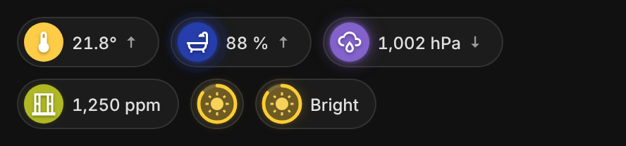

# Climate badges

Four badges for the climate of a room or of the whole home:
`vivid-temperature-badge`, `vivid-humidity-badge`, `vivid-pressure-badge` and
`vivid-air-quality-badge` (CO₂ in ppm). Each measure has its own color scale,
the same one the climate charts use:

- **Temperature**: blue when cold, pale yellow then orange inside the comfort
  range (19–23 °C by default), red when hot.
- **Humidity**: light cyan when dry to deep blue when very humid.
- **Pressure**: violet, dark for a low (stormy) pressure, light for a high one.
  The icon follows the weather it suggests.
- **Air quality**: healthy green to toxic green, with its level in words
  (Excellent, Good, Moderate, Poor, Toxic) in the tooltip and the details. From
  1 000 ppm the icon becomes an open window: time to air the room.

<p>
  
  
</p>

The icon disc is filled with the exact color of the value, with a white icon.
Inside the comfort range there is no halo; outside, a halo in the same color
grows the further the value goes. Temperatures from °F sensors are colored like
their °C equivalent and written in °F.

Small arrows show the trend: a temperature that moved more than 0.5 °C or a
humidity more than 5 points in the last hour, a pressure on its three-hour
trend. A pressure falling more than 3 hPa in three hours turns the halo to an
alert (storm or strong wind likely), a humidity jumping more than 10 points in
15 minutes pulses (a shower), and so does toxic air. The badge fetches this
short history when it appears, then every ten minutes.

With several sensors (a sensor group or `entities`), the badge shows what asks
for action:

- temperature: the range of the rooms (`17,9–22,7°`), the disc split between
  the color of the coldest room and the warmest, the halo in the color of the
  room furthest from comfort;
- humidity: the most humid room (`max 58 %`);
- air quality: the worst room;
- pressure: the mean.

`aggregate` overrides this. Tap a badge for the history of its sensor, or one
curve per room; tap a room for its own chart.

```yaml
- type: custom:vivid-temperature-badge
  entity: sensor.all_temperatures
  comfort: [19, 22]
- type: custom:vivid-humidity-badge
  entity: sensor.sdb_humidite
- type: custom:vivid-pressure-badge
  entity: sensor.sdb_pression
- type: custom:vivid-air-quality-badge
  entities:
    - sensor.salon_co2
    - sensor.bureau_co2
```

| Option      | Default     | Description                                                                                    |
| ----------- | ----------- | ---------------------------------------------------------------------------------------------- |
| `comfort`   | per measure | `[low, high]` in the sensor unit. Defaults: 19–23 °C, 40–60 %, 1 005–1 025 hPa, 400–1 000 ppm. |
| `aggregate` | per measure | `mean`, `median`, `min`, `max` or `sum` instead of the default above.                          |
| `range`     | `24h`       | Span of the details chart: `6h`, `24h`, `7d` or `30d`.                                         |
| `trend`     | `true`      | Trend arrows, shower and pressure drop alerts (not for air quality).                           |

Plus the options of every badge (`name`, `icon`, `look`, `icon_color`, `glow`,
`tap_action`, `hold_action`).

## White icons on colored discs

Every Vivid badge now draws a white icon on its colored disc, with a soft
shadow that keeps it readable on light colors (pale yellow, cyan, lavender, a
white light). `icon_color: auto` brings back the dark icon on very light colors.

| Option       | Default | Description                                          |
| ------------ | ------- | ---------------------------------------------------- |
| `icon_color` | `white` | `white`, or `auto` (dark icon on very light colors). |

## Doors and windows: count and duration

While something is open, a group badge shows how many are open and how long
the oldest has been open: `3/6 · 19 min`. That duration is what turns the
halo amber, then red. `show_count: false` hides both.

## Illuminance from a text sensor

`vivid-illuminance-badge` also reads sensors that report a word instead of lux:
`bright`, `dim`, `dark` (and `light`, `twilight`, `night`… whatever the case).
Each level sits on the same gauge and colors as the lux, with a sun, a dimmed
sun or a moon. The badge shows the icon alone; `show_label: true` also writes
the level (Bright, Dim, Dark).
