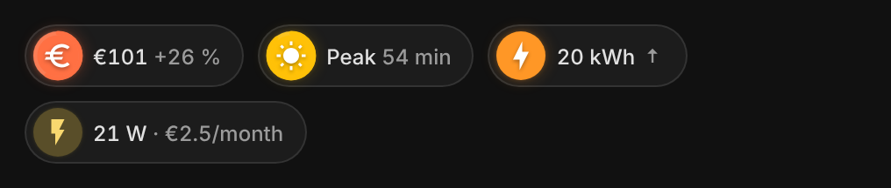

# Energy badges

<p></p>

- **`vivid-bill-badge`**: the estimated bill; its ring goes round with the
  billing cycle and its color tells the gap with the previous bill.
- **`vivid-tariff-badge`**: off-peak or peak hours right now, and the time
  left. Needs only `off_peak_hours`; `icon` for peak hours, `icon_off` for
  off-peak hours.
- **`vivid-energy-badge`**: the last day read in kWh, colored against the
  mean of the week, with its trend.
- **`vivid-power-badge`** with `cost: month` or `cost: hour` and a
  `tariff`: what the power costs at this pace, over 30 days at the day's
  mean price, or per hour at the price of the moment (see
  [status badges](status-badges.md#vivid-power-badge)).

```yaml
badges:
  - type: custom:vivid-bill-badge
    tariff:
      {
        peak: 0.1787,
        off_peak: 0.1344,
        off_peak_hours: ['00:36-05:36'],
        subscription: 16.58,
        billing_day: 12,
      }
    tap_action: { action: navigate, navigation_path: /energy-home/electricity }
  - type: custom:vivid-tariff-badge
    tariff: { off_peak_hours: ['00:36-05:36', '14:06-17:06'] }
```

They take `tariff`, `energy`, `cost` like the [electricity cards](../guides/electricity.md),
and `look`, `tap_action`, `hold_action` like the other badges.
