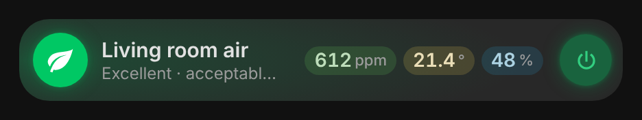

# vivid-air-station-card

A card made for one DIY device, the **Salon Air Station**: an ESP32 under
ESPHome with a CO₂ sensor (SCD4x, which also reads the temperature and the
humidity), a 240 × 240 screen and a frame of 28 LEDs that lights the room in
the color of its comfort. The line keeps what is read every day; a tap opens
everything the firmware offers.

<p>
  
</p>

## What the card shows

One line:

- **The disc**, filled with the station's comfort level (the same four levels
  as its `Comfort Level` sensor: excellent, good, fair, uncomfortable) and the
  halo of the line in that color, like the frame lights the room. The icon
  says what matters: a leaf when all is fine, the reading that is out of
  comfort (CO₂, temperature, humidity), a moon at night, an open window when
  the CO₂ is above the alert threshold. Then the disc and the outline of the
  line pulse red.
- **The name and its state**: the comfort and the station's ventilation advice,
  the night light and its brightness at night, “Station off · still
  measuring” when the frame and the screen are off, “Offline”.
- **The values you pick** (`info`): CO₂, temperature, humidity by default, the
  dew point too. Each one in the color of the climate scales of Vivid Cards,
  outlined when it is outside the comfort range set on the station.
- **The power button**: the station's `Station Power` (frame and screen; the
  readings keep running).

**Details** (tap the line), in four tabs:

- **Air**: the three readings with the station's own words (CO₂ good, fair,
  bad, critical against its thresholds; temperature and humidity against its
  comfort ranges). A tap on one charts it over 6 h, 24 h, 7 days or 30 days,
  with the comfort band set on the station. Then the dew point, the risk of
  condensation (as the humidity page of the screen rates it) and the advice.
- **Frame**: what the 28 LEDs show now (the effect, its color, its
  brightness), whether they follow the pages (one effect per page and the red
  alarm), the eight effects (picking one stops following the pages), the
  brightness: automatic from the light sensor (minimum, maximum, night) or
  manual, and the three color sliders of `Custom Color`.
- **Screen**: the page the station shows, drawn live, the previous and next
  pages, a page to show, the page cycle and its duration, the backlight.
- **Settings**: the four CO₂ thresholds on one slider (they keep their order
  Excellent < Good < Watch < Alarm, which the firmware itself does not check),
  the temperature and humidity comfort ranges, the night threshold of the
  light sensor with its reading now, the device (Wi-Fi, address, uptime) and
  the calibration at 426 ppm, which asks for a second tap.

The frame's color is worked out from the same formulas as the firmware: the
frame itself is not exposed to Home Assistant (`internal: true`).

## Quick start

```yaml
type: custom:vivid-air-station-card
device: 0123456789abcdef0123456789abcdef
name: Living room air
```

Pick the device in the visual editor: the card finds its entities from it.

## Options

| Option       | Default                        | What it does                                                            |
| ------------ | ------------------------------ | ----------------------------------------------------------------------- |
| `device`     |                                | The station (ESPHome device); its entities are found from it            |
| `prefix`     | `salon_salon_air_station_`     | Entity id prefix (the part after the domain); wins over `device`        |
| `entities`   |                                | Single entities that do not follow the prefix, by key (`co2: sensor.…`) |
| `name`       | `Air quality`                  | The card's title                                                        |
| `info`       | `[co2, temperature, humidity]` | Values next to the name: `co2`, `temperature`, `humidity`, `dew_point`  |
| `show_power` | `true`                         | The station's power button                                              |
| `tab`        | `air`                          | Tab the details open on: `air`, `frame`, `screen`, `settings`           |
| `glow`       | `100`                          | Halo strength in percent (0 to 200)                                     |

## The firmware

The card reads the entities of the station's ESPHome YAML (v7) by their
object ids: `sensor.co2`, `sensor.temperature`, `sensor.humidity`,
`sensor.dew_point`, `sensor.comfort_level`, `sensor.ventilation_advice`,
`binary_sensor.co2_alert`, `binary_sensor.night_mode`, `sensor.current_page`,
the switches `station_power`, `screen_backlight`, `auto_page_cycle`,
`led_sync_pages`, `led_auto_brightness`, the select `led_effect`, the numbers
of the thresholds, the comfort ranges, the brightness and the custom color,
and the page and calibration buttons. A station renamed in Home Assistant
keeps working as long as its entity ids end the same; `entities:` points any
key elsewhere.
