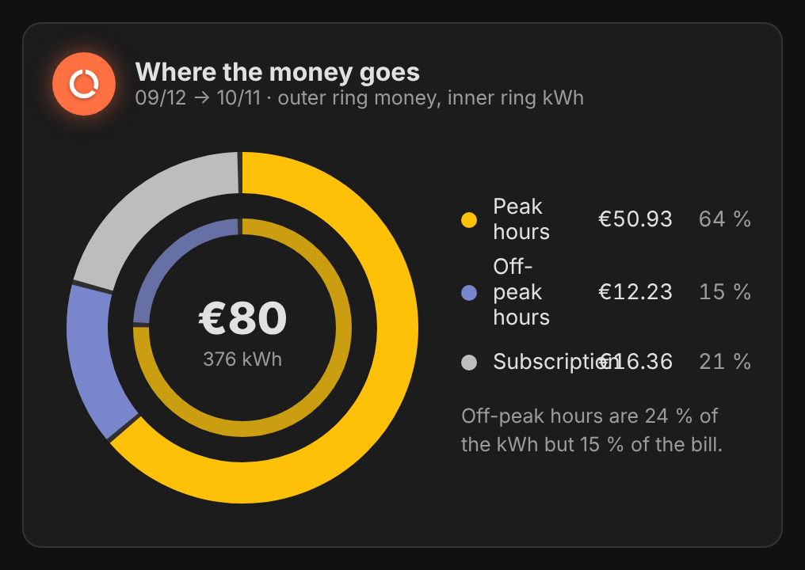
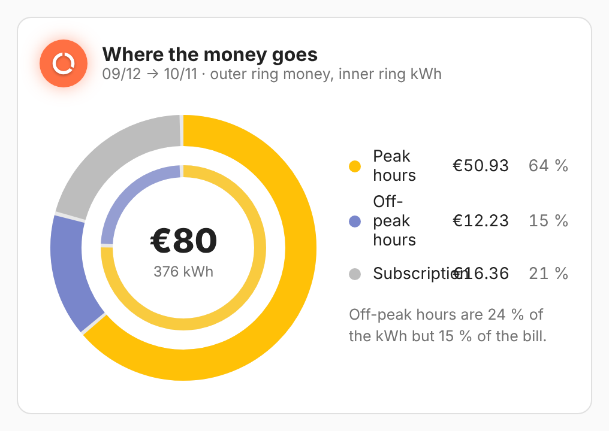
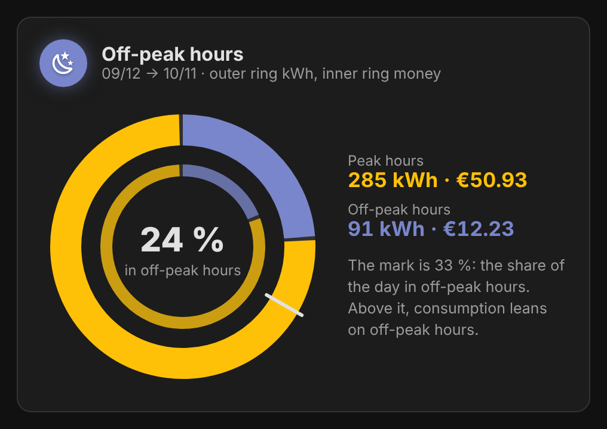
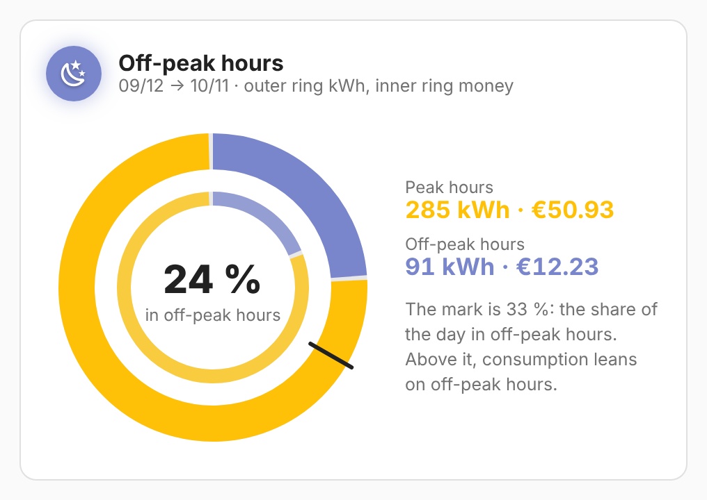

# vivid-bill-ring

A bill as rings. `ring: money` shows where each euro goes (peak, off-peak,
subscription) around the total; `ring: off_peak` shows the share of energy
drawn in off-peak hours, the one that pays off with an off-peak contract.

<p>
  
  
</p>
<p>
  
  
</p>

## Configuration

```yaml
type: custom:vivid-bill-ring
ring: off_peak
cycle: current
```

| Option  | Default | Description                               |
| ------- | ------- | ----------------------------------------- |
| `ring`  | `money` | `money` or `off_peak`.                    |
| `cycle` | `last`  | `last` (the last full bill) or `current`. |

Like every electricity card, it takes `tariff`, `energy`, `cost`, `name` and `glow`: see [Electricity](../guides/electricity.md) for the tariff, the data source and how the projection works.
