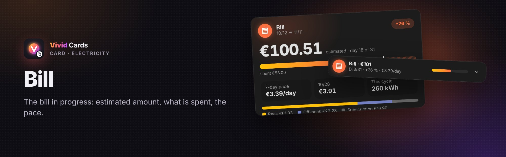
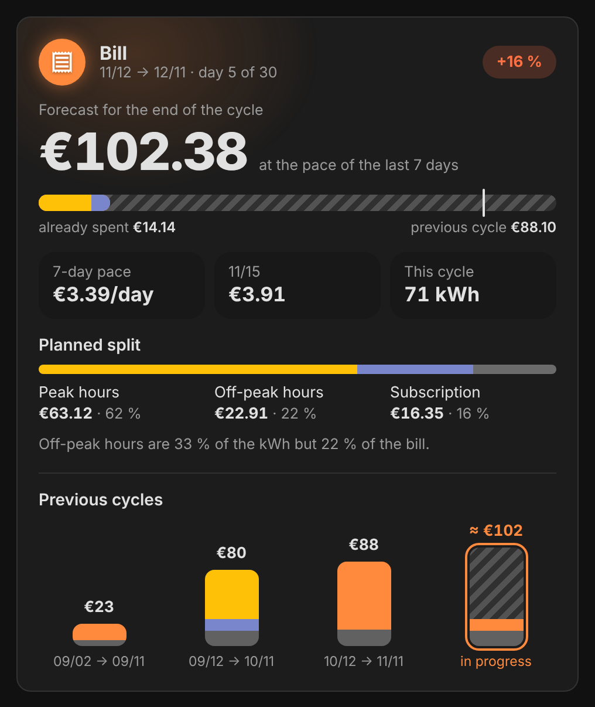
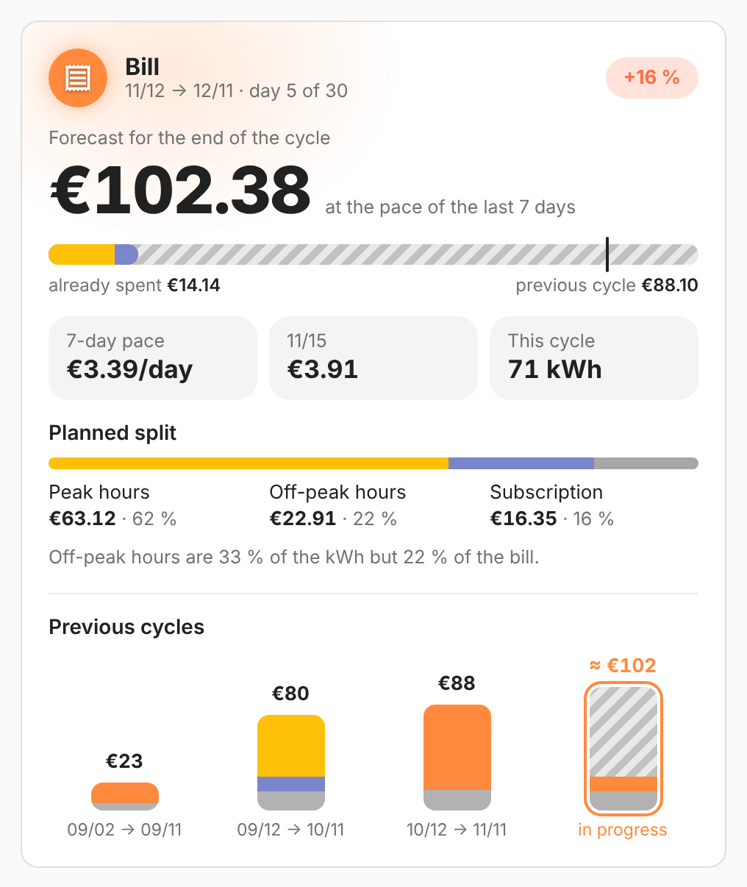
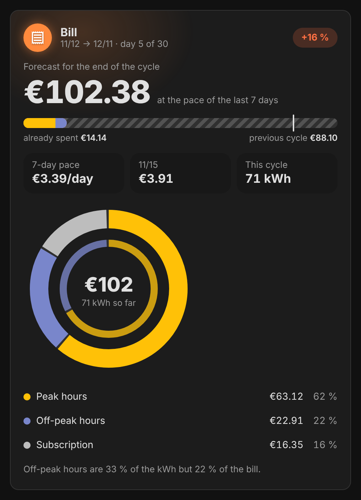
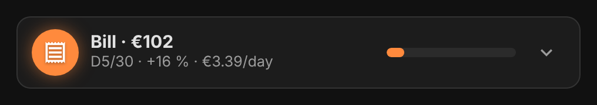

<p align="center">
  
</p>

<sub><a href="../../README.md">Vivid Cards</a> › <a href="../README.md">Documentation</a> › <a href="../README.md#electricity">Electricity</a> › Bill</sub>

# vivid-bill-card

**How much will I pay?** The bill in progress, from top to bottom:

- **The forecast** for the end of the billing cycle, at the pace of the last 7
  days, and its gap with the previous bill (top right).
- **A bar** filling with what is already spent, split between peak and
  off-peak hours; what is still to come is hatched, and the previous bill is a
  mark on it.
- **Three figures**: the 7-day pace, the last day read and the energy of the
  cycle.
- **The planned split** of the forecast between peak hours, off-peak hours and
  the subscription, with what off-peak hours weigh in kWh and in money.
- **The previous cycles**: one small bar each, the one in progress last.

<p>
  
  
</p>

## Layouts

`layout: ring` shows the planned split as a ring (the forecast in the middle,
the kWh read so far split peak / off-peak inside). `layout: line` fits the bill
on one line (forecast, day of the cycle, gap, pace) that unfolds into the
card.

<p>
  
  
</p>

## Configuration

```yaml
type: custom:vivid-bill-card
layout: ring
history: false
tariff:
  peak: 0.1787
  off_peak: 0.1344
  off_peak_hours: ['00:36-05:36', '14:06-17:06']
  subscription: 16.58
  billing_day: 12
```

| Option    | Default | Description                                                                 |
| --------- | ------- | --------------------------------------------------------------------------- |
| `layout`  | `card`  | `card`; `ring`: the planned split as a ring; `line`: one line that unfolds. |
| `history` | `true`  | The previous cycles under the bill.                                         |

Like every electricity card, it takes `tariff`, `energy`, `cost`, `name` and `glow`: see [Electricity](../guides/electricity.md) for the tariff, the data source and how the forecast works. Every electricity card shares one look: the same head and accent, the same period bar, amber for peak hours, indigo for off-peak hours, grey for the subscription and hatching for what is still to come.

## Former cards

This card stands for three former ones, still working but out of the card
picker: [`vivid-bills-card`](bills.md) (the previous cycles are now at the
bottom of this card) and [`vivid-bill-ring`](bill-ring.md) (`layout: ring`).
