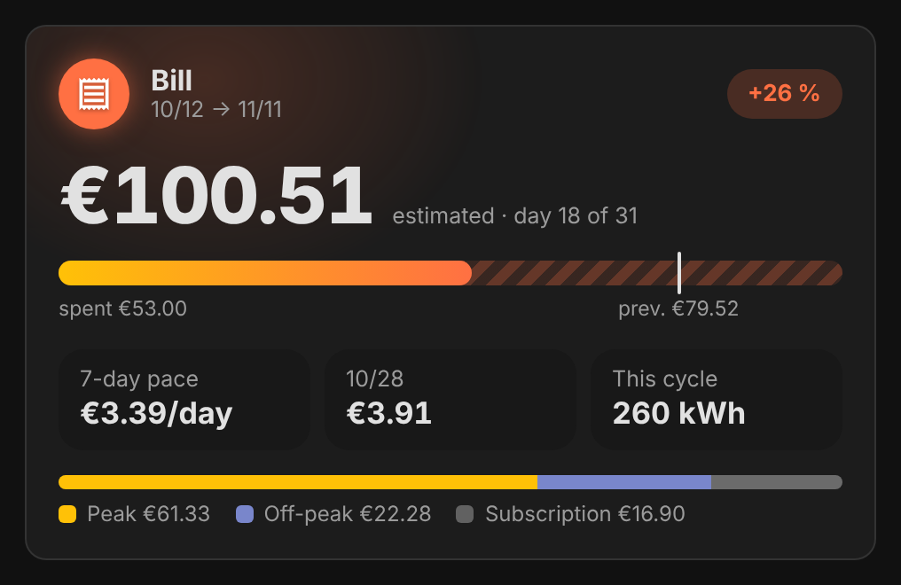
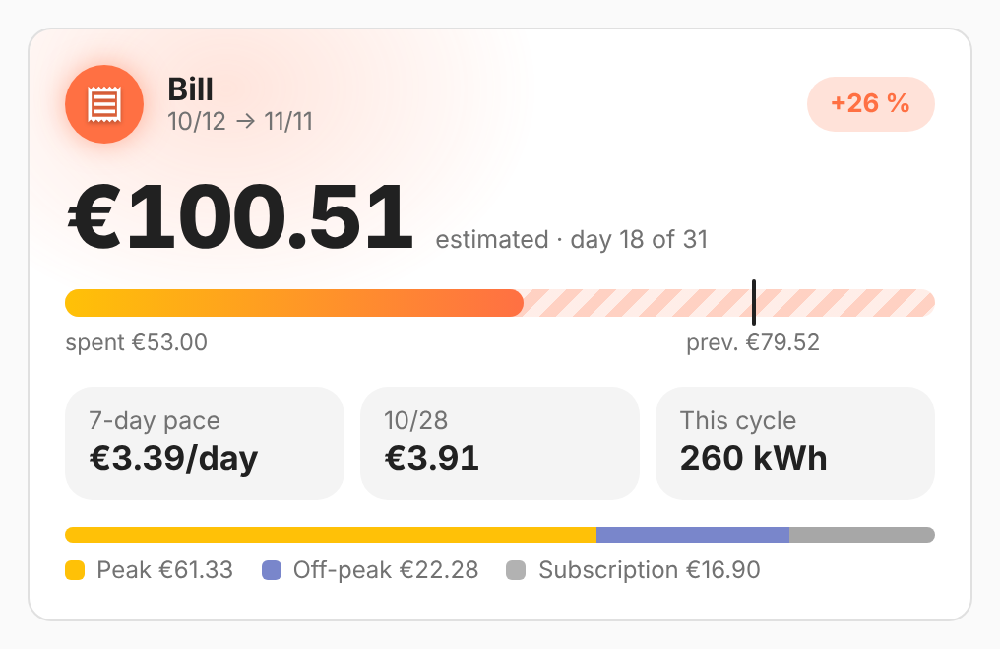
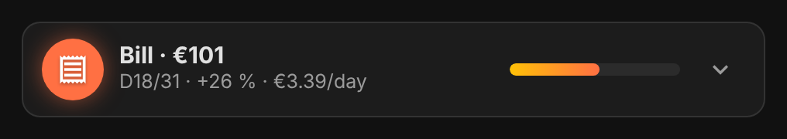

# vivid-bill-card

The bill in progress: its estimated amount at the end of the billing cycle,
what is already spent, the previous bill as a mark on the bar, the gap with it,
the pace of the last 7 days, the last day read and the energy of the cycle,
then the split between peak hours, off-peak hours and subscription.

<p>
  
  
</p>

With `layout: line` it fits on one line (amount, day of the cycle, gap, pace)
and unfolds into the full card:

<p></p>

## Configuration

```yaml
type: custom:vivid-bill-card
layout: line
tariff:
  peak: 0.1787
  off_peak: 0.1344
  off_peak_hours: ['00:36-05:36', '14:06-17:06']
  subscription: 16.58
  billing_day: 12
```

| Option   | Default | Description                               |
| -------- | ------- | ----------------------------------------- |
| `layout` | `card`  | `card`, or `line`: one line that unfolds. |

Like every electricity card, it takes `tariff`, `energy`, `cost`, `name` and `glow`: see [Electricity](../guides/electricity.md) for the tariff, the data source and how the projection works.
