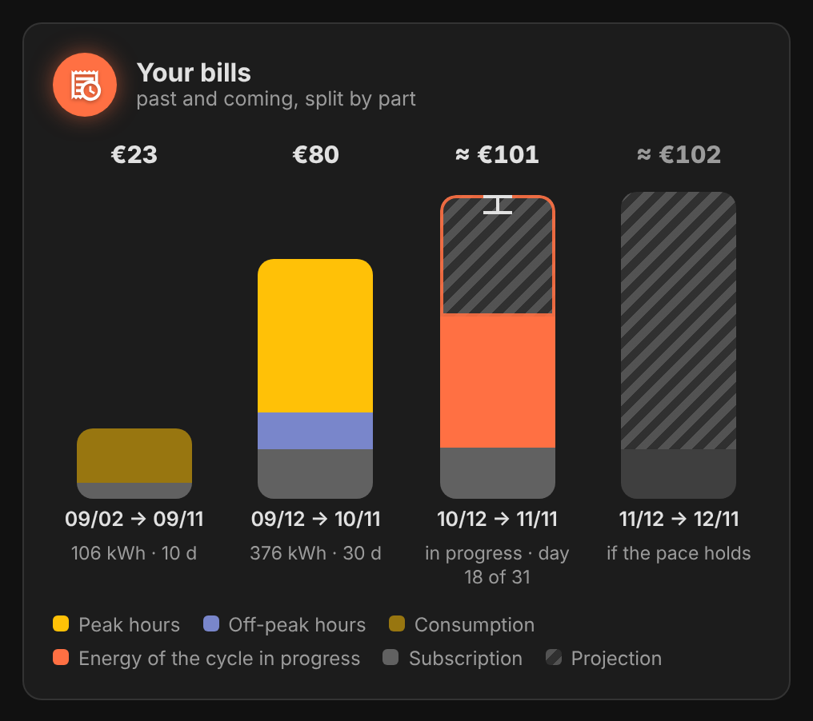
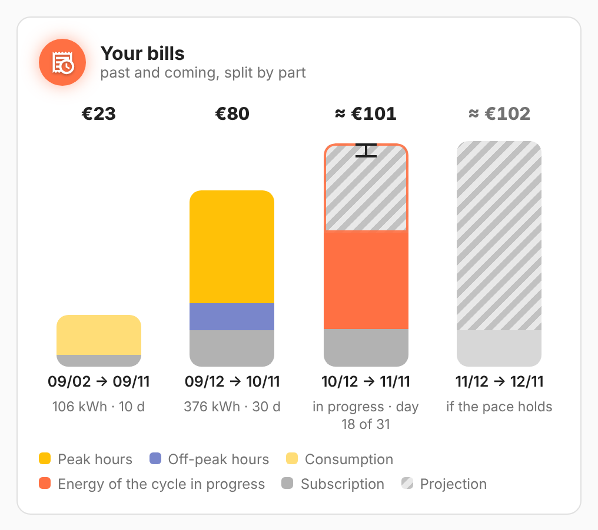

# vivid-bills-card

Your bills side by side: the past ones (from your invoices, or computed from
the statistics), the one in progress with its projection hatched, and the next
one if the pace holds. Each bar is split into peak hours, off-peak hours,
subscription; the in-progress bill shows where the previous one stood.

<p>
  
  
</p>

## Configuration

```yaml
type: custom:vivid-bills-card
count: 4
tariff:
  {
    peak: 0.1787,
    off_peak: 0.1344,
    off_peak_hours: ['00:36-05:36'],
    subscription: 16.58,
    billing_day: 12,
  }
```

| Option  | Default | Description                         |
| ------- | ------- | ----------------------------------- |
| `count` | `4`     | Bars shown, the next bill included. |

Like every electricity card, it takes `tariff`, `energy`, `cost`, `name` and `glow`: see [Electricity](../guides/electricity.md) for the tariff, the data source and how the projection works.
