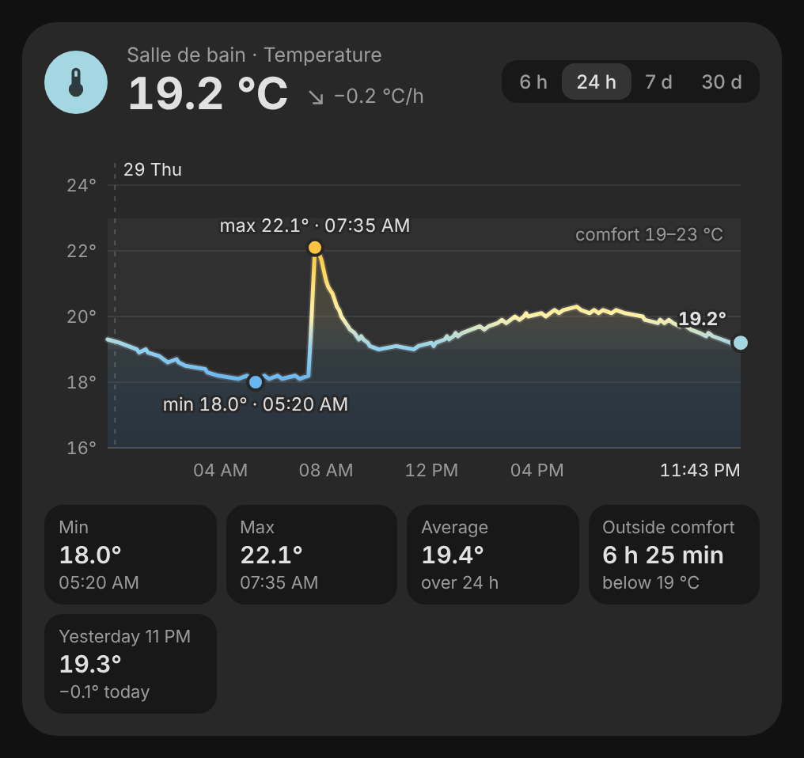
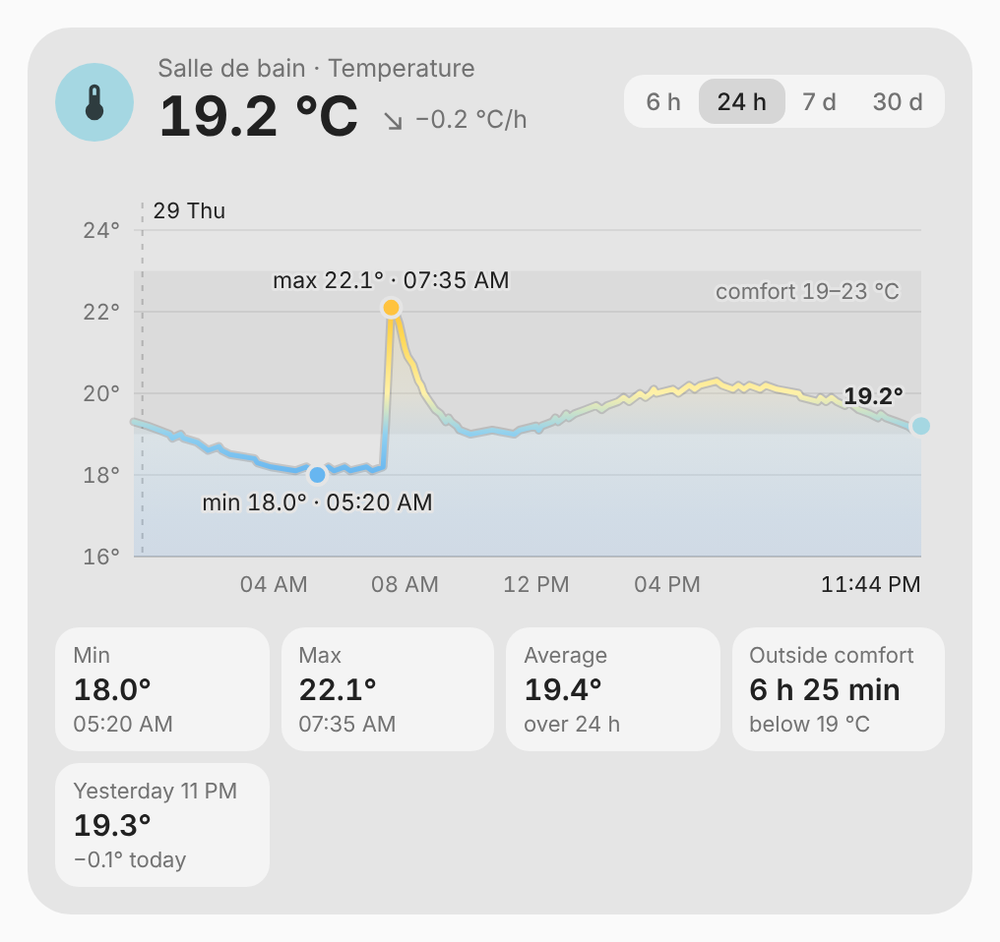
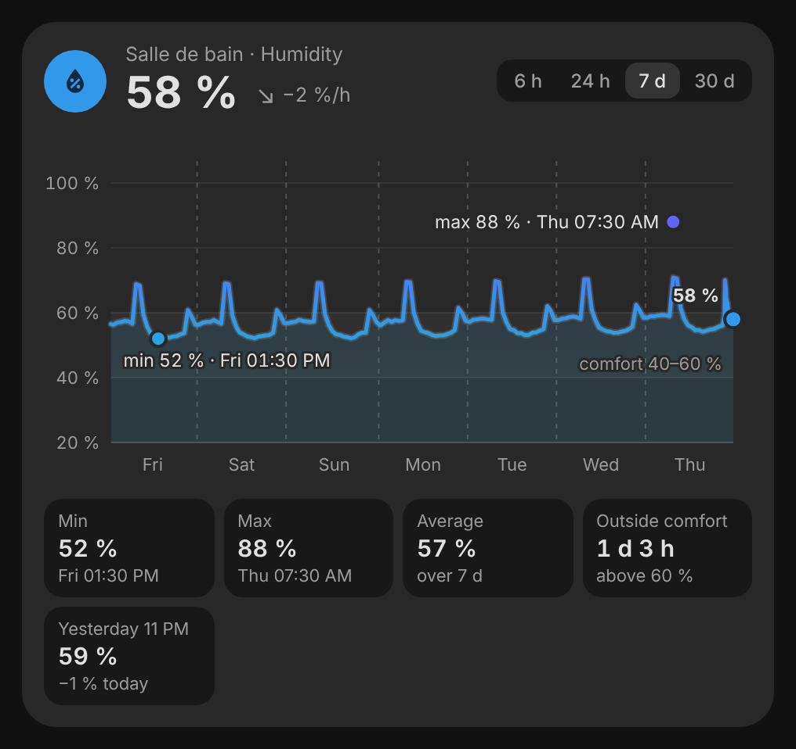
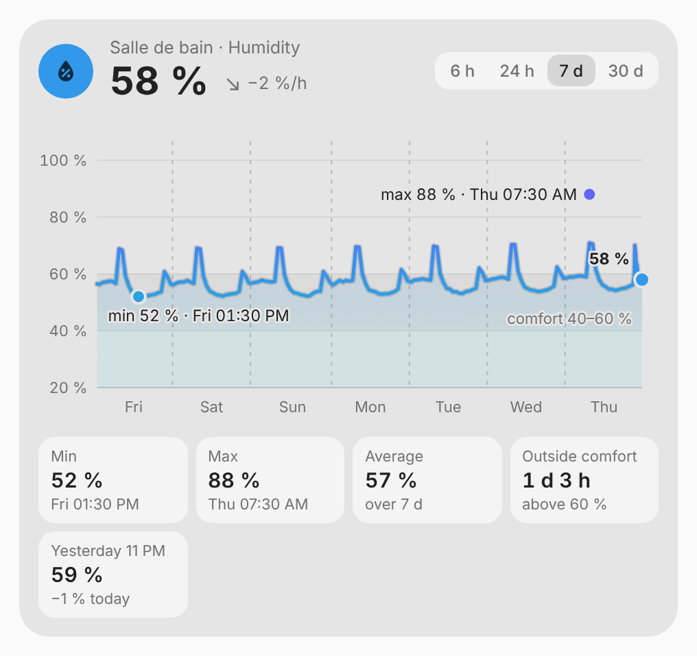

# vivid-climate-card

One climate sensor and its history: the value in large, with its trend per
hour, the curve colored by the value over 6 hours to 30 days, the comfort
band, the dated minimum and maximum, the time spent outside comfort and the
gap with yesterday. It is the chart of the [climate badges](../badges/climate-badges.md)'
details, as a card.

<p>
  
  
</p>
<p>
  
  
</p>

## Configuration

```yaml
type: custom:vivid-climate-card
entity: sensor.bathroom_humidity
range: 7d
comfort: { low: 40, high: 60 }
```

| Option    | Default               | Description                                     |
| --------- | --------------------- | ----------------------------------------------- |
| `entity`  | required              | A sensor, or a numeric sensor group.            |
| `kind`    | from its device class | `temperature`, `humidity`, `pressure` or `co2`. |
| `range`   | `24h`                 | Span shown first: `6h`, `24h`, `7d`, `30d`.     |
| `comfort` | 19–23 °C, 40–60 %, …  | Comfort band, in the sensor's units.            |
| `name`    | the sensor's          | Name above the value.                           |
