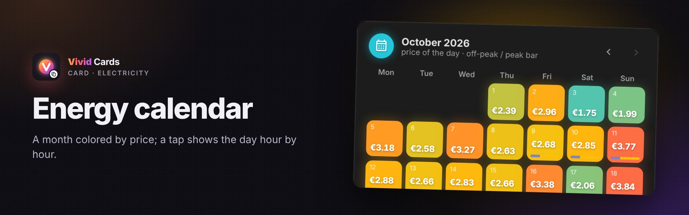
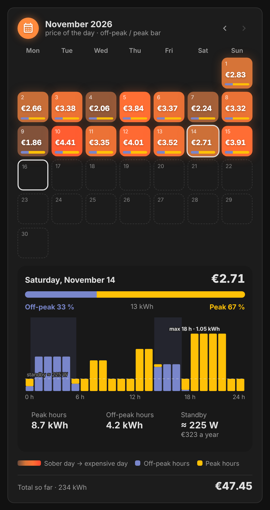
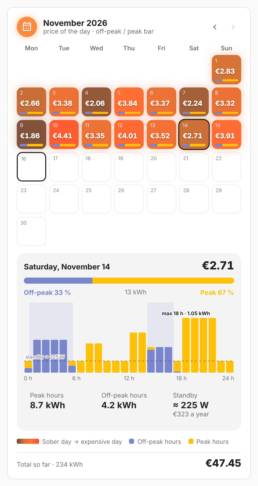
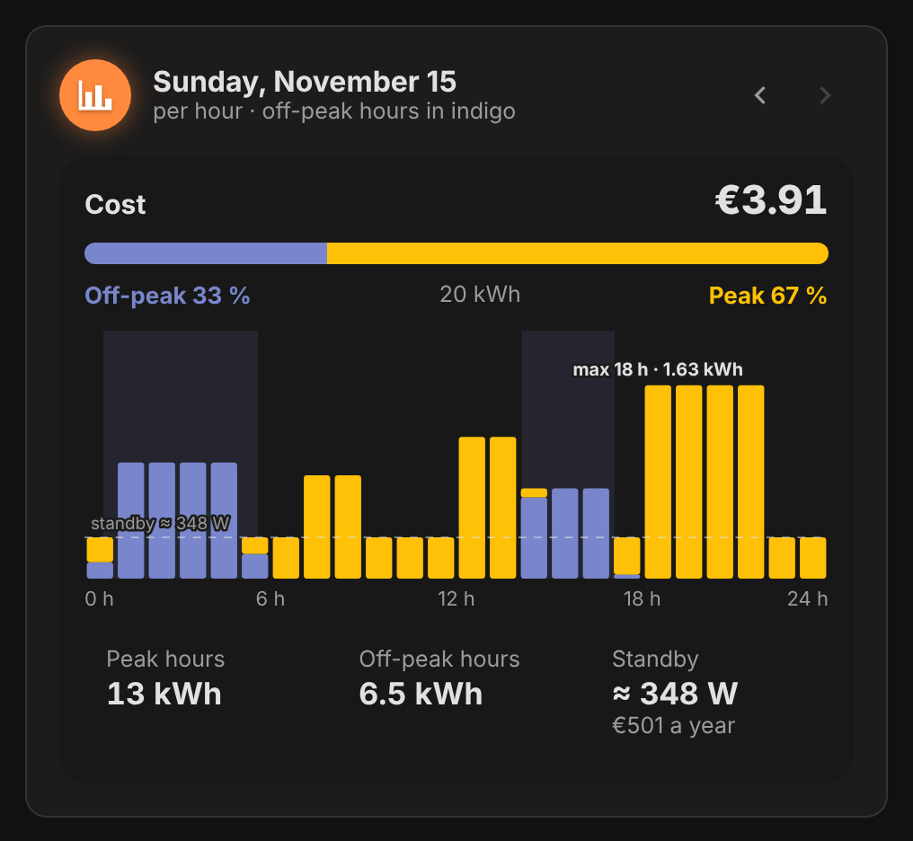

<p align="center">
  
</p>

<sub><a href="../../README.md">Vivid Cards</a> › <a href="../README.md">Documentation</a> › <a href="../README.md#electricity">Electricity</a> › Energy calendar</sub>

# vivid-energy-calendar

**When do I consume?** A month of electricity, one cell per day: its price
(subscription included), an orange that grows more intense the more the day
cost against a usual day, and a bar splitting it between off-peak and peak
hours.

Under the month, the chosen day (the last day read, or the one you tap): its
off-peak / peak split, its curve hour by hour over the off-peak hours, its
peak and off-peak kWh and its standby, with what the standby costs over a
year. The total of the month closes the card.

<p>
  
  
</p>

## One day

`show: day` keeps the day alone, moved day by day with the arrows: the former
load curve card.

<p></p>

## Configuration

```yaml
type: custom:vivid-energy-calendar
show: month
tariff:
  peak: 0.1787
  off_peak: 0.1344
  off_peak_hours: ['00:36-05:36', '14:06-17:06']
  subscription: 16.58
  billing_day: 12
```

| Option | Default | Description                                                                |
| ------ | ------- | -------------------------------------------------------------------------- |
| `show` | `month` | `month`: the month, the chosen day under it; `day`: one day, hour by hour. |

Like every electricity card, it takes `tariff`, `energy`, `cost`, `name` and `glow`: see [Electricity](../guides/electricity.md) for the tariff, the data source and how the forecast works. Every electricity card shares one look: the same head and accent, the same period bar, amber for peak hours, indigo for off-peak hours, grey for the subscription and hatching for what is still to come.

The hourly curve needs hourly statistics: a meter that only sends one value a
day shows the month, without the curve.

## Former card

[`vivid-load-curve`](load-curve.md) still works but left the card picker: it
is `show: day`.
