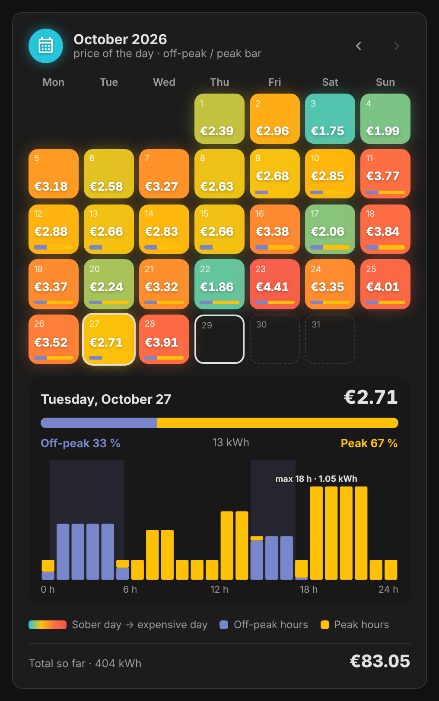
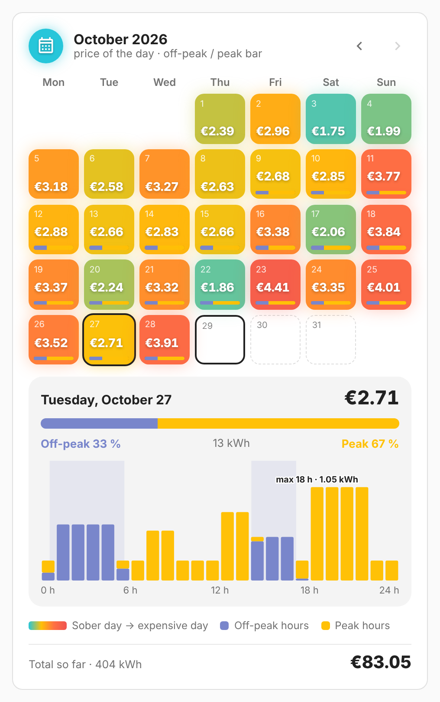

# vivid-energy-calendar

A month, one cell per day colored by what the day cost, from a sober day to an
expensive one (against the month and the 30 days before), with its off-peak bar
when the day is known hour by hour. The arrows step back month by month.

A tap on a day opens its detail: the date, the price, the off-peak / peak split
and **the day hour by hour**, amber for peak hours and indigo for off-peak
hours, with the busiest hour pointed out.

<p>
  
  
</p>

## Configuration

```yaml
type: custom:vivid-energy-calendar
```

No option of its own. The split and the hour-by-hour view need hourly data
(Linky: once the hourly collection is on); until then a day shows its price
and energy, and says so.

Like every electricity card, it takes `tariff`, `energy`, `cost`, `name` and `glow`: see [Electricity](../guides/electricity.md) for the tariff, the data source and how the projection works.
