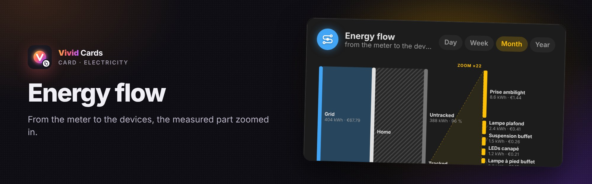
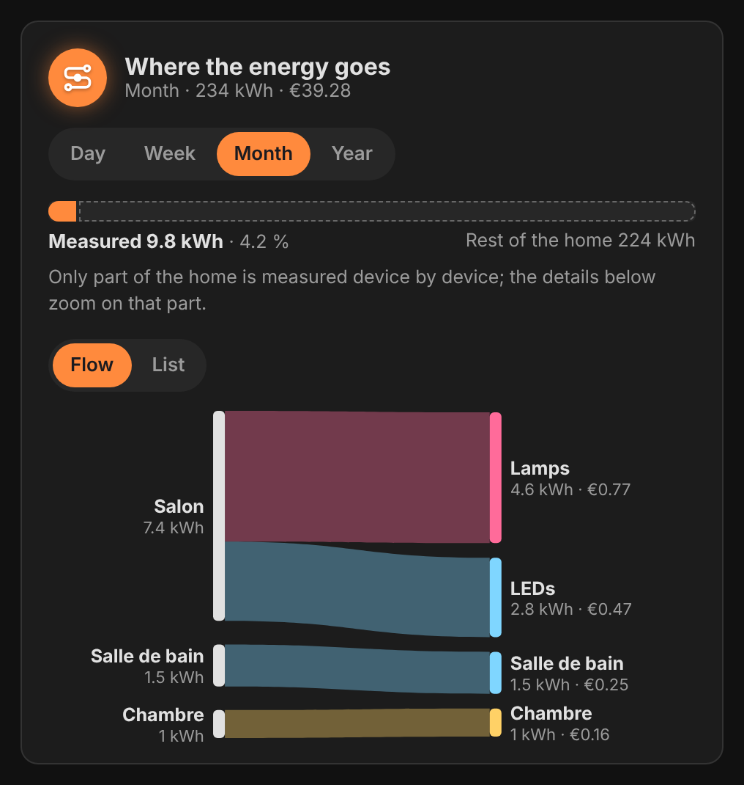
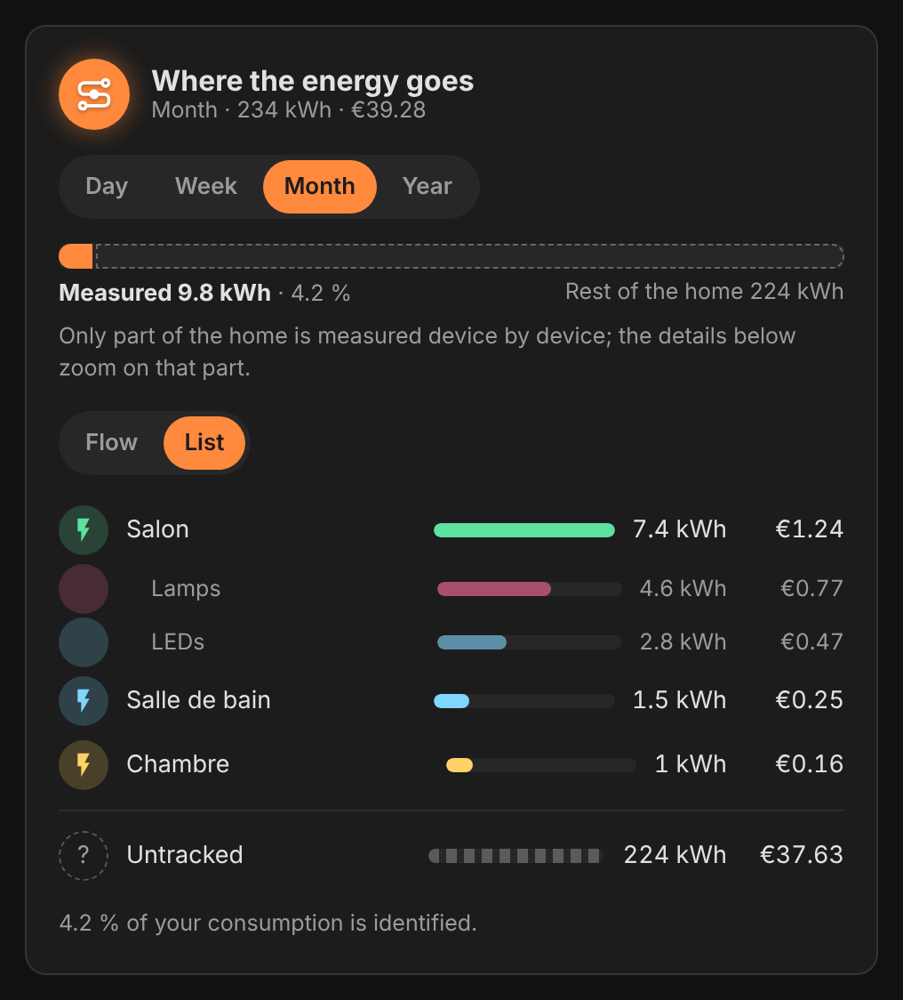

<p align="center">
  
</p>

<sub><a href="../../README.md">Vivid Cards</a> › <a href="../README.md">Documentation</a> › <a href="../README.md#electricity">Electricity</a> › Where the energy goes</sub>

# vivid-energy-flow

**Where does the energy go?** Over a day, a week, a month or a year:

- **The measured part**: of what the meter shows, the share devices measure,
  the rest of the home apart (dashed). Most homes measure only a little device
  by device, so the details zoom on that part instead of crushing it.
- **Flow**: the rooms on the left, their lights, LEDs and switches on the
  right, each band as thick as its kWh, with its kWh and its cost.
- **List**: the same, ranked, each room with its lights, LEDs and switches
  under it, then what no device measures.

Each consumer keeps its color everywhere, from one period to the next.

<p>
  
  
</p>

The rooms and their lights, LEDs and switches come from
[Vivid Pilot](https://github.com/Florian-BARRE/vivid-pilot) (their energy
sensors); `entities.devices` adds or leaves out consumers, or lists them by
hand.

## Configuration

```yaml
type: custom:vivid-energy-flow
period: month
view: flow
max_devices: 6
```

| Option        | Default | Description                                                       |
| ------------- | ------- | ----------------------------------------------------------------- |
| `period`      | `month` | `day`, `week`, `month` or `year`; the bar on the card changes it. |
| `view`        | `flow`  | `flow`, or `list`; the switch on the card changes it.             |
| `max_devices` | `6`     | Rooms drawn one by one; the others are grouped.                   |

Like every electricity card, it takes `tariff`, `energy`, `cost`, `name` and `glow`: see [Electricity](../guides/electricity.md) for the tariff, the data source and how the forecast works. Every electricity card shares one look: the same head and accent, the same period bar, amber for peak hours, indigo for off-peak hours, grey for the subscription and hatching for what is still to come.

## Former card

[`vivid-energy-ranking`](energy-ranking.md) still works but left the card
picker: it is `view: list`.
