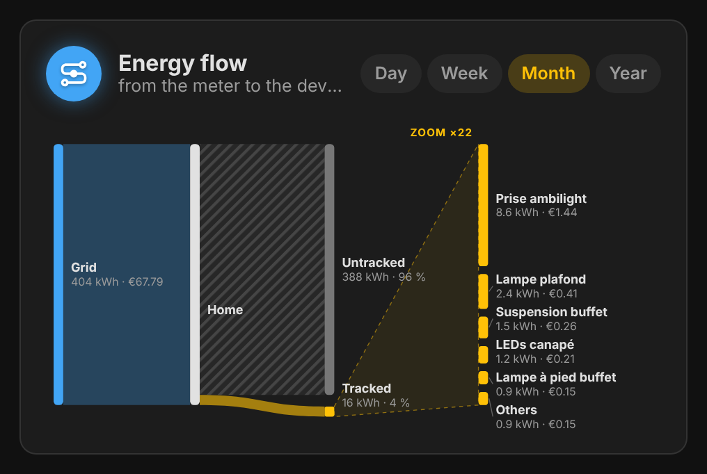
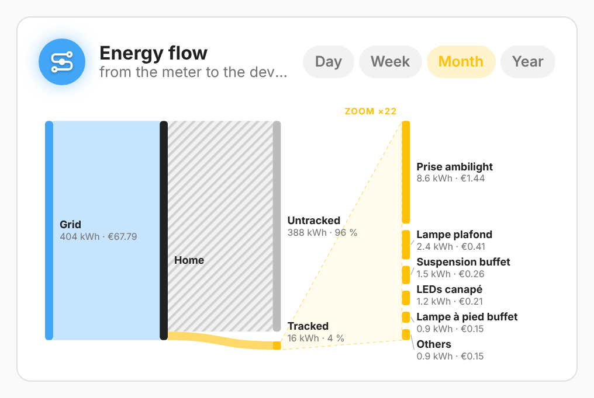

# vivid-energy-flow

From the meter to the devices: the grid, the home, and what the measured
devices take, zoomed in on the right so small devices stay readable, with what
no sensor measures. Day, week, month or year.

<p>
  
  
</p>

## Configuration

```yaml
type: custom:vivid-energy-flow
period: month
max_devices: 6
```

| Option        | Default | Description                                         |
| ------------- | ------- | --------------------------------------------------- |
| `period`      | `month` | `day`, `week`, `month` or `year` (chips change it). |
| `max_devices` | `6`     | Devices drawn; the rest is grouped.                 |

Devices come from the Energy dashboard (**Individual devices**).

Like every electricity card, it takes `tariff`, `energy`, `cost`, `name` and `glow`: see [Electricity](../guides/electricity.md) for the tariff, the data source and how the projection works.
