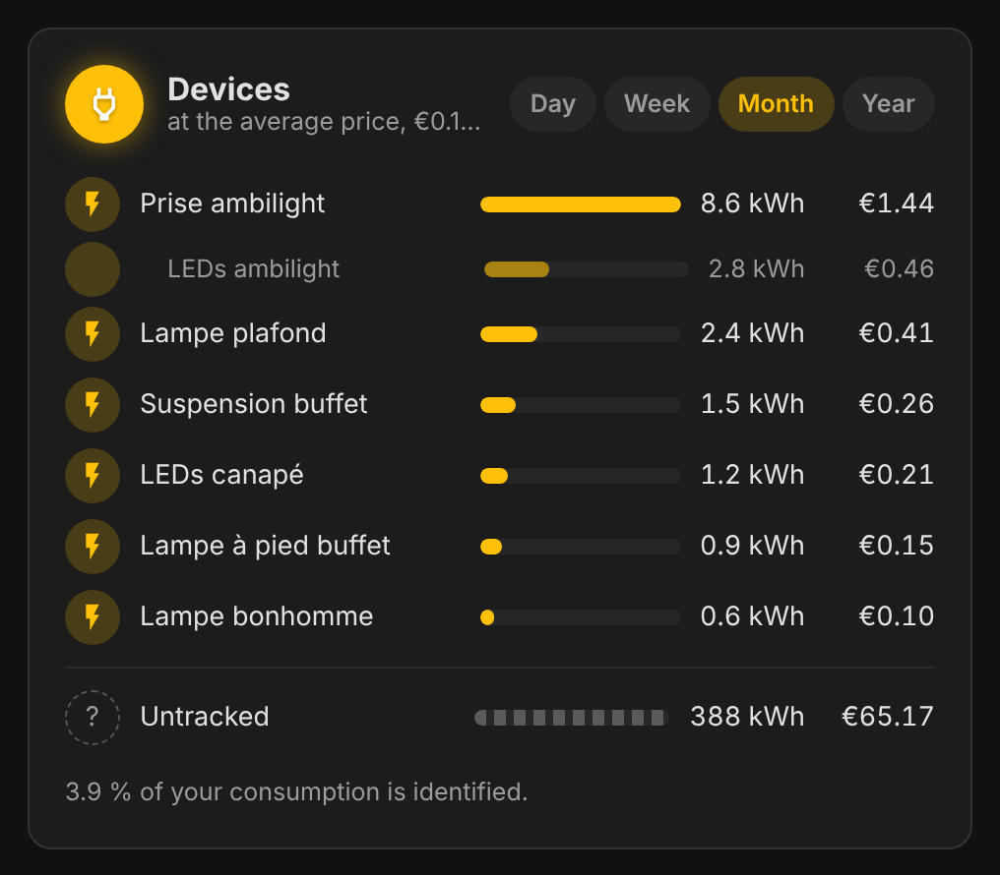
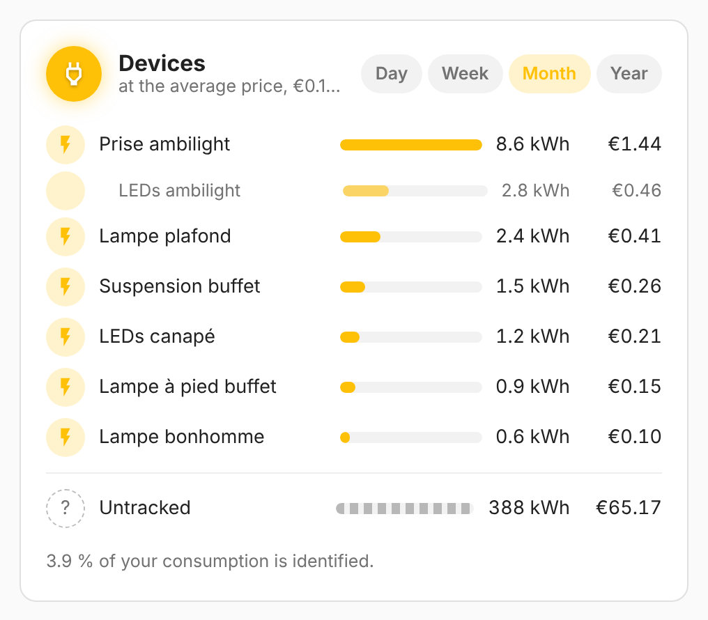

# vivid-energy-ranking

The devices ranked by energy and cost over the period, nested devices under
their parent, with the share nothing measures.

<p>
  
  
</p>

## Configuration

```yaml
type: custom:vivid-energy-ranking
period: week
```

| Option        | Default | Description                       |
| ------------- | ------- | --------------------------------- |
| `period`      | `month` | `day`, `week`, `month` or `year`. |
| `max_devices` | `6`     | Devices listed.                   |

Like every electricity card, it takes `tariff`, `energy`, `cost`, `name` and `glow`: see [Electricity](../guides/electricity.md) for the tariff, the data source and how the projection works.
