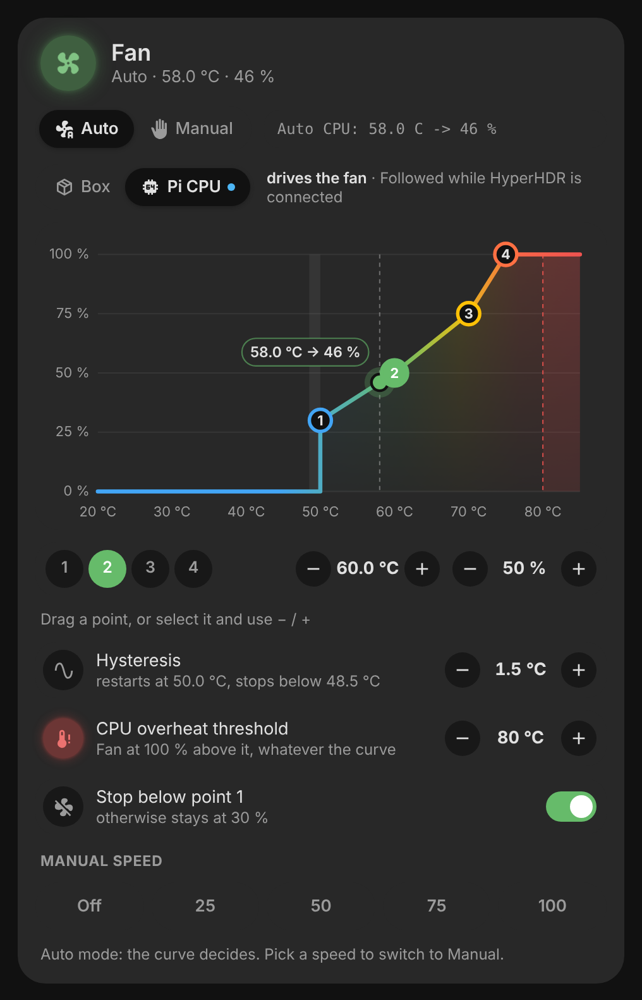
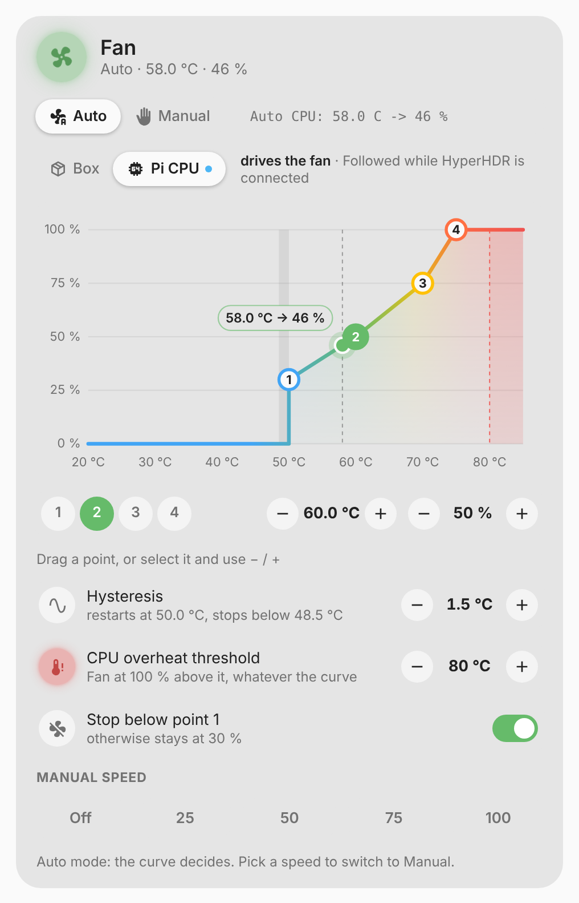

# vivid-fan-card

The fan of the [Ambilight box](ambilight.md) on its own card: its mode, its
speed, the temperature that drives it and the curve it follows, editable point
by point. It is the **Ventilation** tab of the Ambilight card's details, for
dashboards that want it in sight.

<p>
  
  
</p>

## What the card shows

- **The head**: the fan icon turning with the speed, colored by the health of
  the box; the mode (auto or manual), the driving temperature and the speed.
- **Auto / Manual** and, with the HyperHDR firmware, which curve drives the
  fan: the box's temperature or the Pi's CPU (while HyperHDR is connected).
- **The curve**: four points, the hysteresis band, the overheat zone and the
  current temperature on it. Drag a point, or pick it and use − / +.
- **Hysteresis, overheat threshold, stop below point 1**, then the manual
  speeds (a tap on one switches to manual).

## Configuration

```yaml
type: custom:vivid-fan-card
device: 0123456789abcdef # the ESPHome device of the box (or prefix:)
```

| Option     | Default            | Description                                                     |
| ---------- | ------------------ | --------------------------------------------------------------- |
| `device`   | found by itself    | The Ambilight manager ESPHome device.                           |
| `prefix`   | the default prefix | Entity id prefix of the device, instead of `device`.            |
| `entities` |                    | Entities that do not follow the prefix (same keys as the card). |
| `name`     | Fan                | Title.                                                          |
| `glow`     | `100`              | Halo strength in percent (0–200).                               |

It reads the box exactly like [`vivid-ambilight-card`](ambilight.md#options):
every option of that card is accepted, the ones above are the ones that
matter here.
