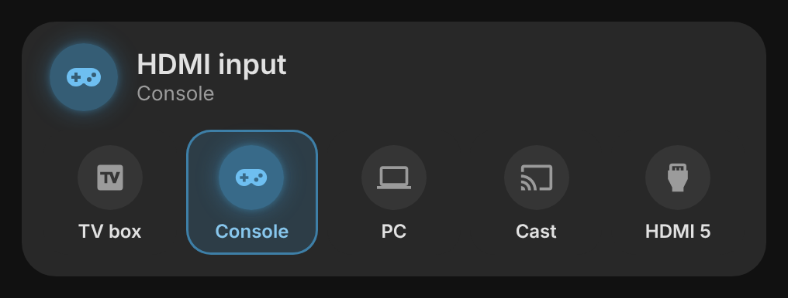
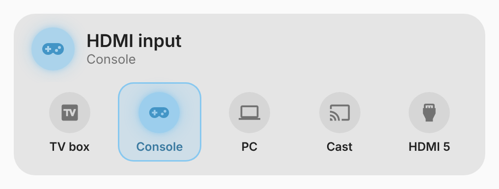

# vivid-hdmi-card

The HDMI inputs of the [Ambilight box](ambilight.md) as big tiles. A tap sends
the input by infrared; the tile pulses while it is sent, turns green when the
switch's echo confirms it, red when nothing came back. An input changed with
the original remote lights up too.

<p>
  
  
</p>

## Configuration

```yaml
type: custom:vivid-hdmi-card
inputs:
  - { name: TV box, icon: mdi:television-box }
  - { name: Console, icon: mdi:gamepad-variant }
  - { name: PC, icon: mdi:laptop }
  - { name: Cast, icon: mdi:cast }
  - HDMI 5
```

| Option   | Default         | Description                                                  |
| -------- | --------------- | ------------------------------------------------------------ |
| `device` | found by itself | The Ambilight manager ESPHome device (or `prefix`).          |
| `inputs` | HDMI 1…5        | Names and icons of the inputs, in order; a string is a name. |
| `name`   | HDMI input      | Title.                                                       |
| `glow`   | `100`           | Halo strength in percent (0–200).                            |

The head shows the active input; the inputs share their names with the
[Ambilight card](ambilight.md), so set them once in both, or copy the list.
