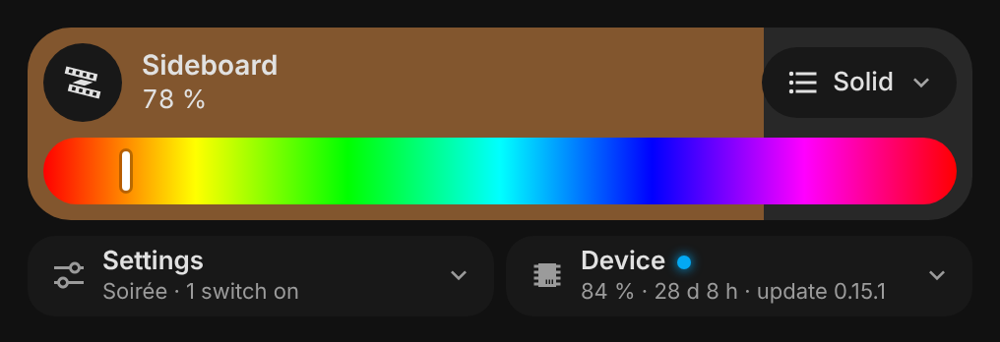
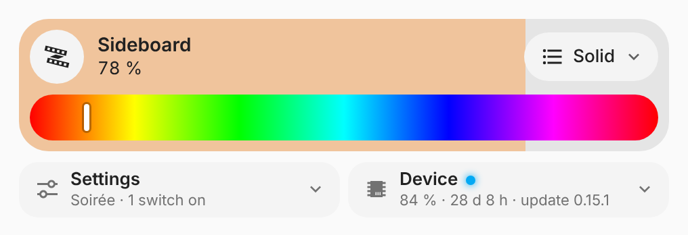
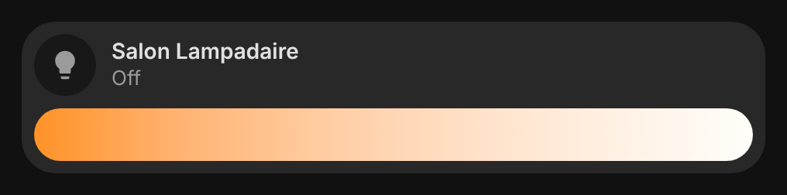
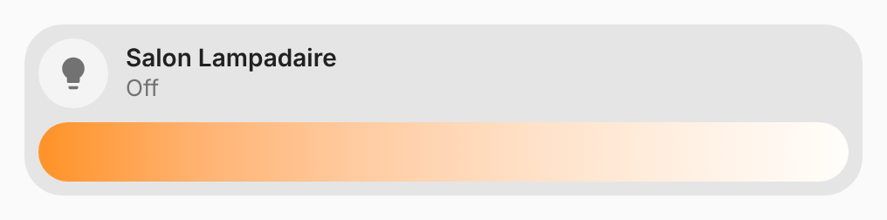

# vivid-light-card

One light as a Vivid tile: drag across it to dim, tap to toggle, hold for its
dialog. The tile is filled with the light's real color, with its color or
white bar and its effects. A WLED strip also gets its **Settings** and
**Device** panels under the tile (preset, palette, speed, intensity, sync;
Wi-Fi, uptime, LEDs, firmware update and restart).

<p>
  
  
</p>
<p>
  
  
</p>

For a group of lights, with the consumption and the details of each one, use
[`vivid-led-group`](led-group.md) or [`vivid-lamp-group`](lamp-group.md).

## Configuration

```yaml
type: custom:vivid-light-card
entity: light.sideboard_wled
```

| Option      | Default  | Description                                       |
| ----------- | -------- | ------------------------------------------------- |
| `entity`    | required | The light.                                        |
| `name`      | its name | Name on the tile.                                 |
| `icon`      | its icon | Icon of the tile.                                 |
| `effects`   | `true`   | The effect picker.                                |
| `color_bar` | `auto`   | `auto`, `hue`, `temperature` or `none`.           |
| `wled`      | `true`   | For a WLED strip, the Settings and Device panels. |
| `glow`      | `100`    | Halo strength in percent (0–200).                 |
