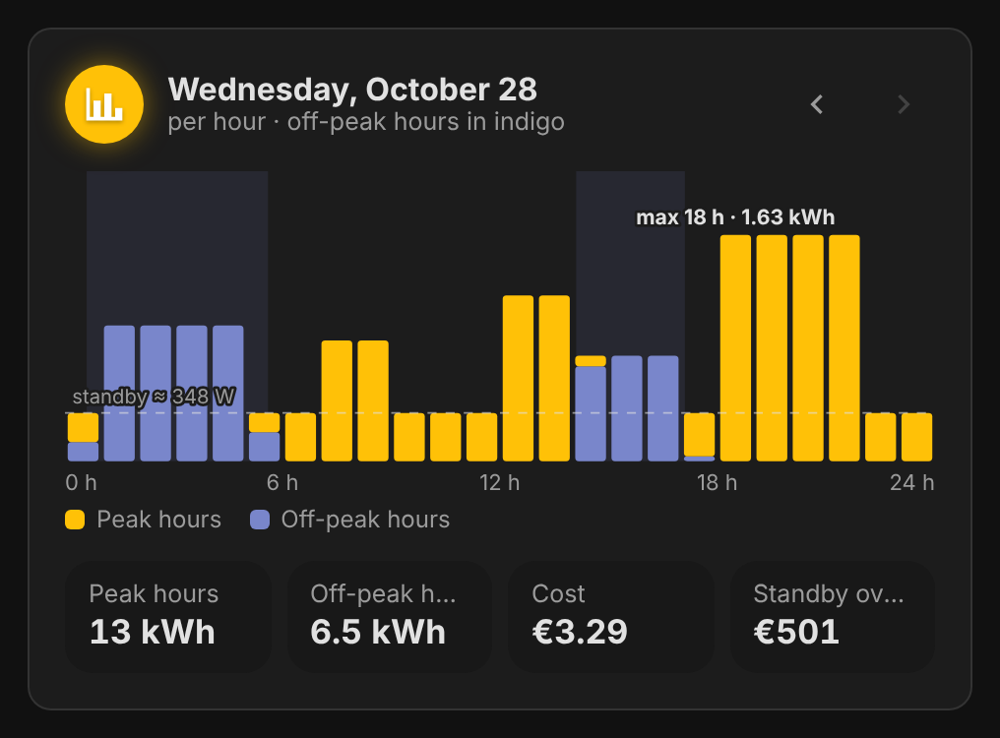
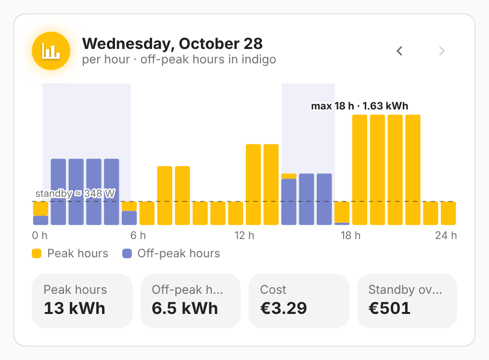

# vivid-load-curve

The load curve of a day hour by hour over the off-peak bands: amber for what
falls in peak hours, indigo for off-peak hours, the busiest hour pointed out,
and the standby, the power that never stops, with what it costs a year. The
arrows step through the last week.

<p>
  
  
</p>

## Configuration

```yaml
type: custom:vivid-load-curve
```

Needs hourly data (Linky: the hourly collection); until then it says so.

Like every electricity card, it takes `tariff`, `energy`, `cost`, `name` and `glow`: see [Electricity](../guides/electricity.md) for the tariff, the data source and how the projection works.
