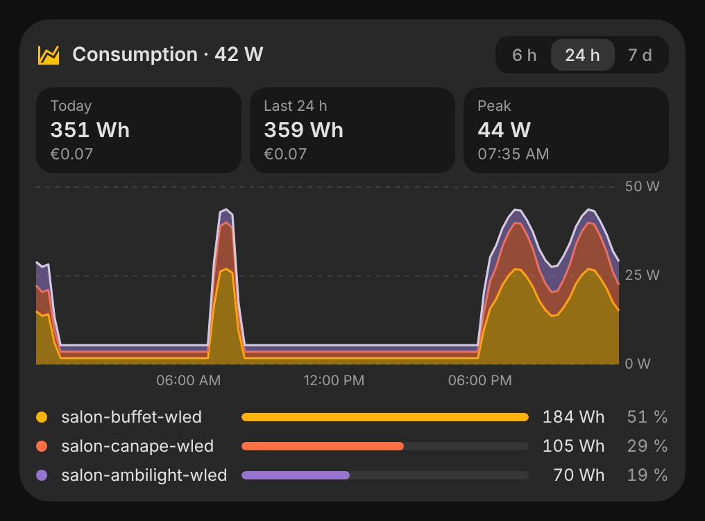
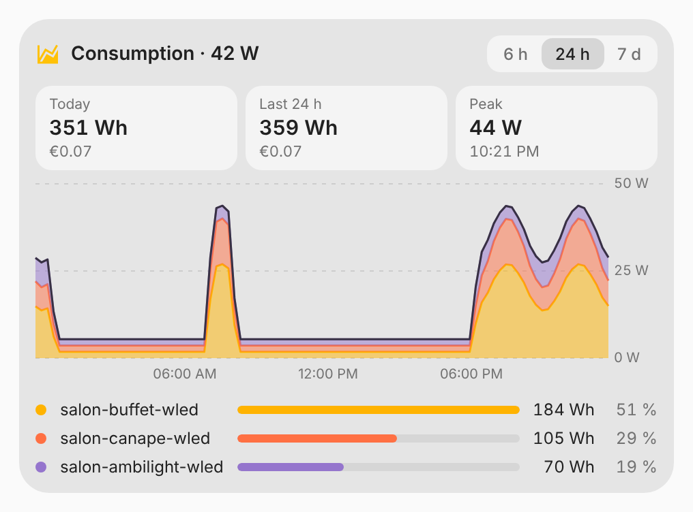

# vivid-power-card

The consumption of a few lights or devices over 6 hours, 24 hours or 7 days:
one stacked area per device, the energy of today and of the period with its
cost, the peak, and a cursor that reads every device at a given time. The
title carries what they draw right now.

<p>
  
  
</p>

## Configuration

```yaml
type: custom:vivid-power-card
entities:
  - light.sideboard_wled
  - light.sofa_wled
  - sensor.tv_power
voltage: 5 # WLED strips without a power sensor: estimated current × voltage
price: 0.1952
```

| Option     | Default          | Description                                                 |
| ---------- | ---------------- | ----------------------------------------------------------- |
| `entities` | required         | Lights, switches or power sensors.                          |
| `voltage`  |                  | Strip voltage, to turn WLED's estimated current into watts. |
| `price`    |                  | Price of a kWh, for the cost.                               |
| `currency` | Home Assistant's | ISO 4217 code.                                              |
| `name`     | Consumption      | Title.                                                      |

A light's consumption is found like in the [LED group](led-group.md#where-consumption-comes-from):
a power sensor on its device, else WLED's estimated current with the voltage.
The 7 days view reads the long-term statistics: the sensors need a
`state_class`.
