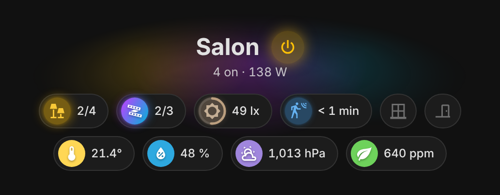
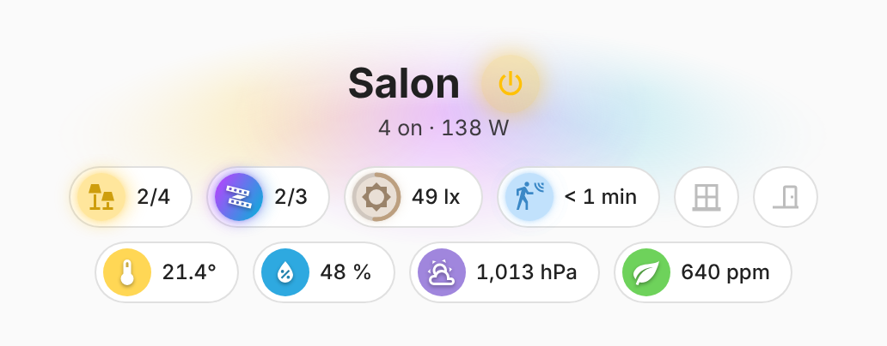

# vivid-room-header

The header of a room, in one card: its title with the room power button next
to it, the lights on and the consumption under it ("4 on · 138 W", or
"everything is off"), and the room badges centered below. Behind the title,
one soft glow per light source, in its real color: amber for the lamps and
switches, each LED strip in its current color, each as bright as the light.
No glow when everything is off; colors fade smoothly (instantly with reduced
motion).

It replaces the usual stack of a spacer, a title card, a badge row and a
separate power badge.

<p>
  
  
</p>

```yaml
type: custom:vivid-room-header
room: salon
```

## Discovery

With `room: salon`, the card finds the room's entities from the way group
helpers are named: a helper titled `salon-présence` gets the entity id
`binary_sensor.salon_presence`. Each role is matched by entity id
(`<domain>.<room>_<role>`) **or** by name (friendly or registry name
`<room>-<role>`), accents, case and separators ignored, so a helper titled
"Salon-Présence" is found even when its entity id is different. French and
English role names both work.

| Role (aliases)                             | Domain        | Feeds                                     |
| ------------------------------------------ | ------------- | ----------------------------------------- |
| `lampes` (`lamps`)                         | switch, light | Lights (count, power button, halo), badge |
| `leds` (`led`)                             | light         | Lights, LED badge                         |
| `interrupteurs` (`switches`)               | switch, light | Lights, light badge                       |
| `puissance` (`power`)                      | sensor        | Consumption under the title               |
| `eclairement` (`illuminance`)              | sensor        | Illuminance badge                         |
| `presence` (`occupancy`)                   | binary_sensor | Presence badge                            |
| `fenetres` (`windows`), `portes` (`doors`) | binary_sensor | Window and door badges                    |
| `temperature`, `humidite` (`humidity`)     | sensor        | Temperature and humidity badges           |
| `pression` (`pressure`), `co2` (`air`)     | sensor        | Pressure and air quality badges           |

Badges follow the order of this table. Batteries are not a room role (the
battery badge belongs to a home-wide view). Lights on are counted per member
of the light groups (two lamps and two strips on make "4 on"). A tap on the
power button turns everything in the room off when something is on, otherwise
turns the room's lights on; a hold opens the more-info of the main group (the
first light, or `entity`).

## Three ways to set it up

**Automatic** — everything found for the room:

```yaml
type: custom:vivid-room-header
room: salon
```

**Automatic, with exclusions and extra badges** — `exclude` takes roles
(French or English) or entity ids. `badges` are **added** after the
discovered ones; a badge on an entity that was discovered **replaces** its
discovered badge, to change its options. `lights` and `power` still replace
those roles.

```yaml
type: custom:vivid-room-header
room: salon
exclude:
  - co2
  - windows
  - binary_sensor.salon_presence
badges:
  - type: custom:vivid-door-badge # replaces the discovered door badge
    entity: binary_sensor.salon_portes
    warn_after: 5
  - type: custom:vivid-power-badge # added at the end
    entity: sensor.salon_puissance
```

**Manual** — `discover: false` (or no `room`): only `lights`, `power` and
`badges`.

```yaml
type: custom:vivid-room-header
name: Coin TV
discover: false
lights:
  - light.salon_leds
power: sensor.salon_puissance
badges:
  - type: custom:vivid-led-badge
    entity: light.salon_leds
```

The visual editor shows one chip per role found, with its entity id: tap one
to leave it out (it is added to `exclude`). Extra badges are set in YAML.

## Options

| Option          | Default                | Description                                                                 |
| --------------- | ---------------------- | --------------------------------------------------------------------------- |
| `room`          |                        | Room of the naming convention (`salon`, `Salle de bain`).                   |
| `discover`      | `true` with a `room`   | Find the room's entities; `false` for a fully manual card.                  |
| `exclude`       |                        | Roles (`presence`, `windows`…) or entity ids to leave out of the discovery. |
| `name`          | the room, capitalized  | Title.                                                                      |
| `lights`        | discovered light roles | Lights and switches (or groups) of the room.                                |
| `power`         | discovered `puissance` | Power sensor (W or kW).                                                     |
| `entity`        | first light            | More-info opened by a hold on the power button.                             |
| `badges`        |                        | Vivid badges added (`type: custom:vivid-…` plus their options), see above.  |
| `show_subtitle` | `true`                 | Lights on and consumption under the title.                                  |
| `show_badges`   | `true`                 | Badge row.                                                                  |
| `glow`          | `100`                  | Halo strength in percent (0–200), or `off`, `soft`, `normal`, `strong`.     |

Set `room`, or a `name` with its `lights` or `badges`.
