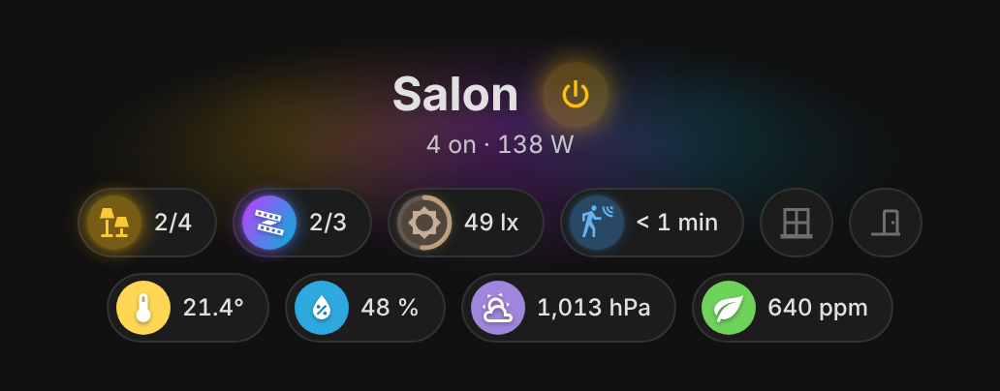
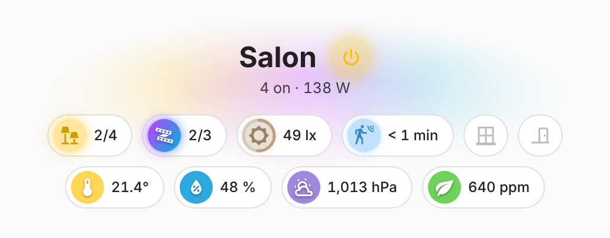

# vivid-room-header

The header of a room, in one card: its title with the room power button next
to it, the lights on and the consumption under it ("4 on · 138 W", or
"everything is off"), and the room badges centered below. Behind the title,
one soft glow per light source, in its real color: amber for the lamps and
switches, each LED strip in its current color, each as bright as the light.
No glow when everything is off; colors fade smoothly (instantly with reduced
motion).

It replaces the usual stack of a spacer, a title card, a badge row and a
separate power badge.

<p>
  
  
</p>

```yaml
type: custom:vivid-room-header
pilot: salon
```

Everything comes from [Vivid Pilot](https://github.com/Florian-BARRE/vivid-pilot):
pick the room, and its lights, power, badges and turn-on scene follow what
Vivid Pilot sorted into it. Nothing is looked up by entity name.

## Set up in the editor

The editor follows the card from top to bottom (YAML is optional):

- **Source**: Vivid Pilot or manual. With Vivid Pilot, pick a room, or
  **Home** (`pilot: all`) for a header of the whole home; everything below
  then comes from what Vivid Pilot sorted into it, and stays adjustable.
  Manual asks for every entity in the same sections.
- **Title**: the title (the room's name unless you write one), the subtitle,
  and the lamps, LEDs, switches and power it counts — the power button and
  the halo use the same lights.
- **Power button**: when it shows, and what a tap does. With Vivid Pilot, a
  tap with everything off restores the room's last lighting (its memory
  scene) or turns the lamps and LEDs on (`power_button.on: lights`); a tap
  with a light on turns them off. Any Home Assistant action can replace
  either way, and the hold.
- **Badges**: every badge the room can show, ticked when shown, in their
  order (arrows), the hidden ones below. A row unfolds to where its entity
  comes from (Vivid Pilot, adjustable, or picked by hand) and its options:
  name, icon, tap and hold actions, "shown only when". Free badges (a kind
  on any entity) can be added.
- **Look**: halo.

## Roles

The roles are Vivid Pilot's categories; each reads what Vivid Pilot generated
for the room.

| Role                         | Vivid Pilot entity                   | Feeds                                     |
| ---------------------------- | ------------------------------------ | ----------------------------------------- |
| `light`                      | the room's light group               | Lights (count, power button, halo), badge |
| `led`                        | the room's LED group                 | Lights, LED badge                         |
| `switch`                     | the room's switch group              | Lights, light badge                       |
| `power`                      | the room's power                     | Consumption under the title               |
| `illuminance`                | the room's mean illuminance          | Illuminance badge                         |
| `presence`, `window`, `door` | on when any of the room's sensors is | Presence, window and door badges          |
| `temperature`, `humidity`    | the room's mean                      | Temperature and humidity badges           |
| `pressure`, `co2`            | the room's mean                      | Pressure and air quality badges           |
| `battery`                    | the room's lowest battery            | Battery badge                             |

Lights on are counted per member of the light groups (two lamps and two
strips on make "4 on").

## In YAML

```yaml
type: custom:vivid-room-header
pilot: sdb
name: Salle de bain # default: the area's name
entities:
  presence: false
  led: { exclude: [light.vivid_pilot_sdb_led], add: [light.wled_miroir] }
power_button:
  on_action:
    {
      action: perform-action,
      perform_action: scene.turn_on,
      target: { entity_id: scene.sdb_douce },
    }
badges:
  - slot: temperature
    tap_action: { action: more-info }
  - slot: '*'
  - type: custom:vivid-illuminance-badge
    entity: sensor.capteur_illumination
    visibility: [{ condition: state, entity: binary_sensor.vivid_pilot_sdb_presence, state: 'on' }]
```

## Options

| Option          | Default         | Description                                                                                                                         |
| --------------- | --------------- | ----------------------------------------------------------------------------------------------------------------------------------- |
| `pilot`         |                 | Vivid Pilot room: its area id (`salon`), or `all` for the whole home.                                                               |
| `name`          | the area's name | Title.                                                                                                                              |
| `entities`      |                 | One slot per role: absent (Pilot), `{exclude, add}`, an entity or a list (manual), `false` (off).                                   |
| `entity`        | first light     | Entity whose more-info a hold opens by default.                                                                                     |
| `power_button`  |                 | `on` (`memory` or `lights`), `on_action`, `off_action`, `hold_action` (Home Assistant actions), `show` (`auto`, `always`, `never`). |
| `badges`        | `[{slot: "*"}]` | Badges in order: `{slot: role}`, `{slot: "*"}`, or a free badge `{type, entity}`; each with its options and `visibility`.           |
| `show_subtitle` | `true`          | Lights on and consumption under the title.                                                                                          |
| `show_badges`   | `true`          | Badge row.                                                                                                                          |
| `glow`          | `100`           | Halo strength in percent (0–200), or `off`, `soft`, `normal`, `strong`.                                                             |
