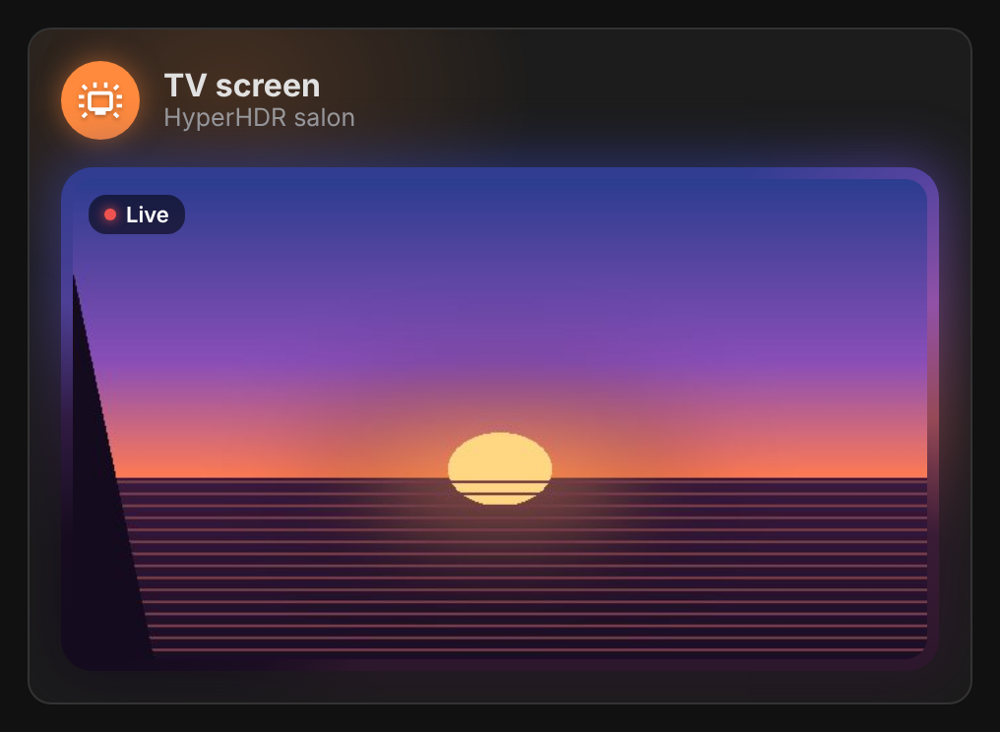
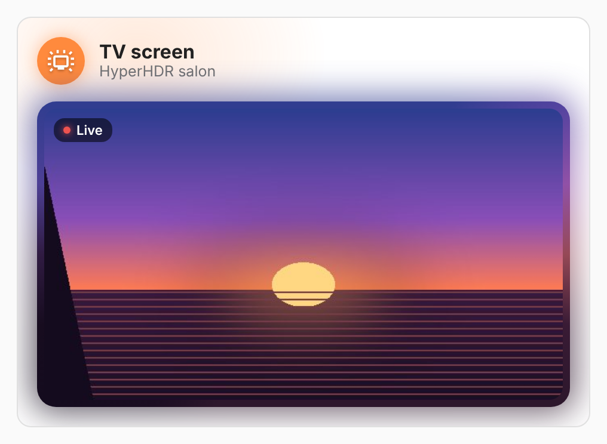

# vivid-screen-card

What the TV shows, as HyperHDR captures it: the live picture in a frame lit by
the colors of its own edges. It plays while it is on screen and stops a moment
after it leaves it, so a dashboard left open does not pull pictures for
nothing.

<p>
  
  
</p>

Needs the [HA-HyperHDR](https://github.com/Florian-BARRE/HA-HyperHDR)
integration with its admin password set (the captured picture camera). The
card finds the camera of the HyperHDR server by itself.

## Configuration

```yaml
type: custom:vivid-screen-card
on_demand: true # a button starts the picture, for 2 minutes
```

| Option      | Default            | Description                                                        |
| ----------- | ------------------ | ------------------------------------------------------------------ |
| `camera`    | HyperHDR's capture | Any camera entity to show instead.                                 |
| `on_demand` | `false`            | The picture plays only once asked (it can be extended or stopped). |
| `timeout`   | `120`              | Seconds it plays once asked.                                       |
| `name`      | TV screen          | Title.                                                             |
| `glow`      | `100`              | Halo strength in percent (0–200).                                  |
